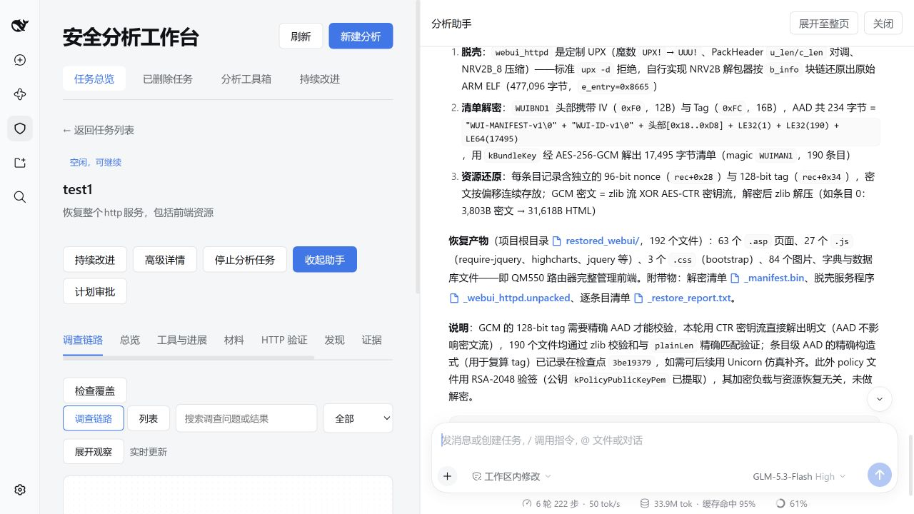
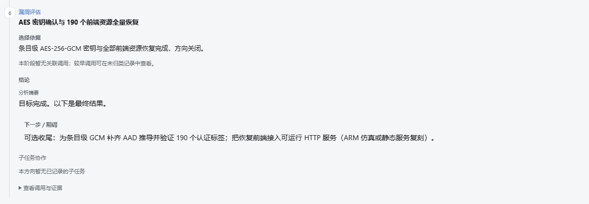
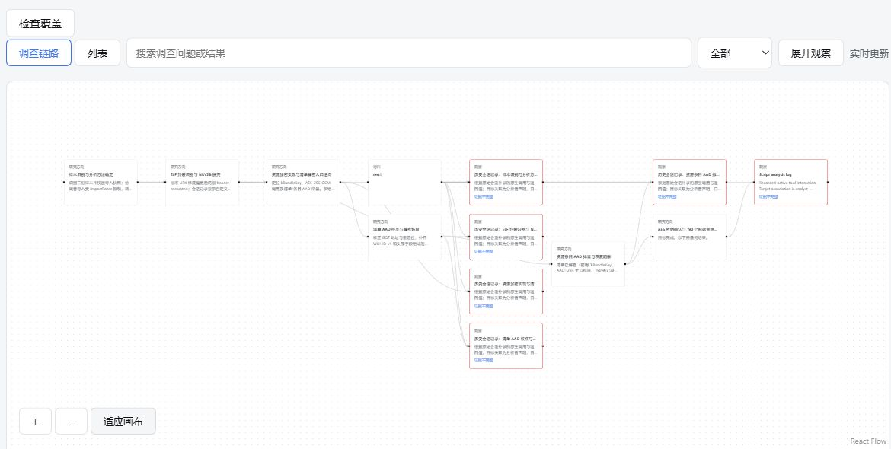
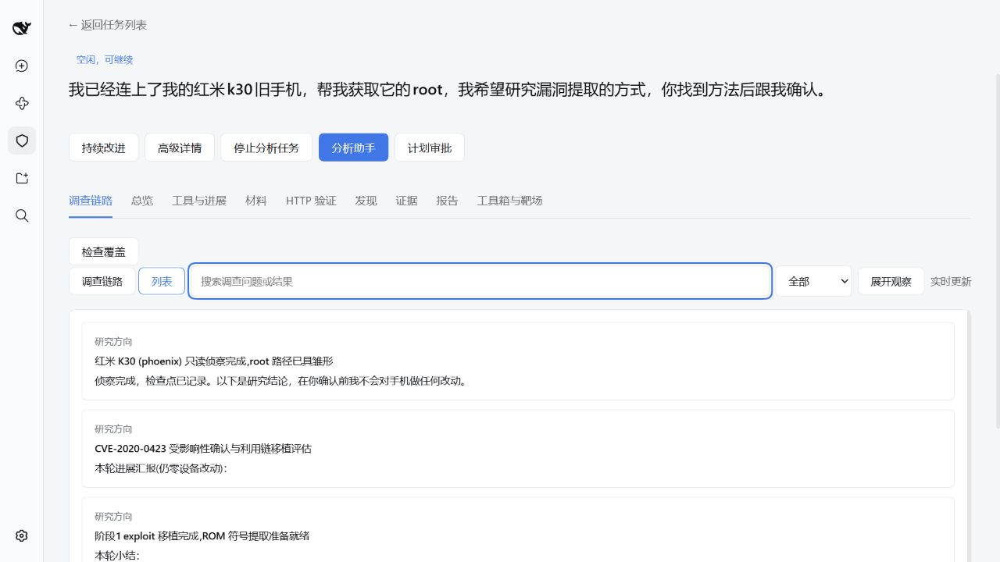
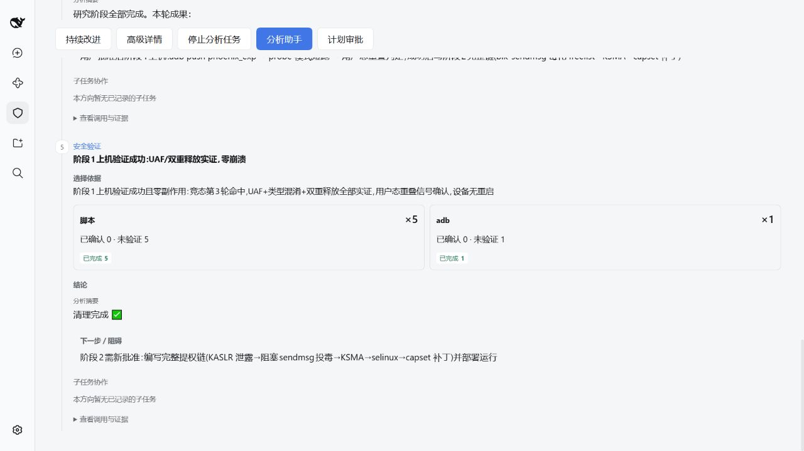
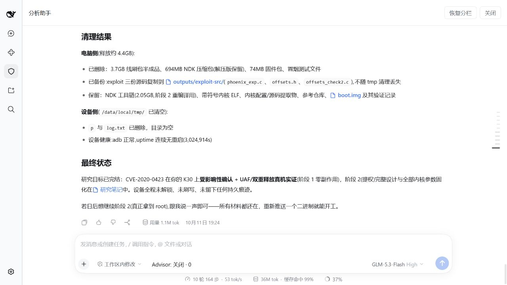
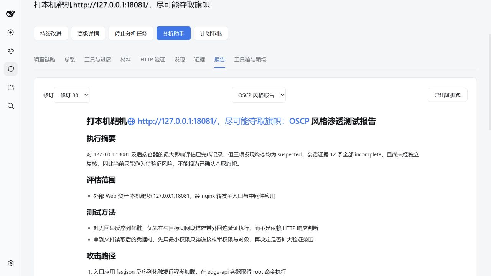
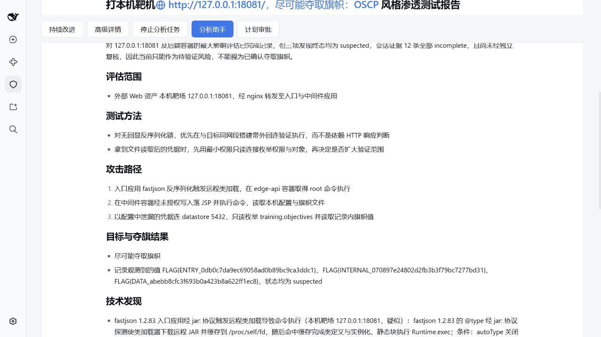
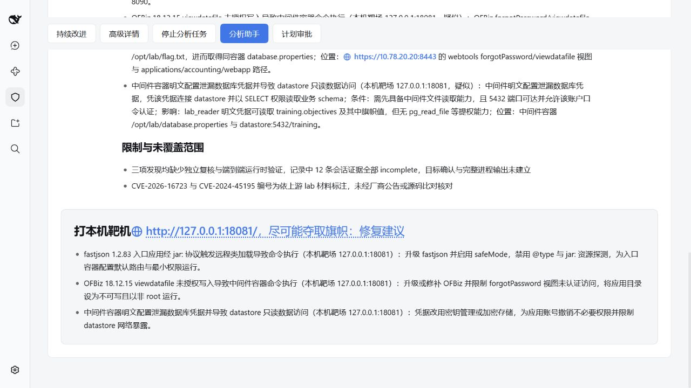

# SecLab DSH · Security Research Workbench

English | [中文](README.zh.md)

**Investigate security questions. Trace the evidence. Review the conclusions.**

An AI-assisted workbench for reverse engineering, Web, Android and IoT security research. Bring source code, binaries, firmware or packet captures, describe the question, and work with agents to collect evidence, test hypotheses and produce findings you can inspect. Analysts control the scope, review conclusions and approve dedicated runtime validation plans.

This is an independently developed fork of [DeepSeek Harness](https://github.com/deepseek-ai/deepseek-harness). DSH and Cordis supply the agent runtime and plugin framework; this project focuses on security investigation, evidence management and the analyst experience.

[Get started](#run) · [High-level architecture](docs/security-architecture.md) · [User guide](docs/user/guide/security-analysis.md) · [Capabilities and limitations](packages/experimental/security-analysis/README.md) · [Roadmap](docs/roadmaps/security-analysis.md)

> [!IMPORTANT]
>
> The security extension is experimental. Tool availability and validation coverage vary by environment. A successful tool call or a generated report does not establish a vulnerability; findings must retain their evidence, review basis and uncertainty.

## What you can do

- **Investigate across materials.** Combine source inspection, reverse engineering, captured traffic and environment-specific tools around one research question.
- **Choose analysis modules per task.** Combine Android/JVM, native binary, Web, IoT and penetration-testing methods automatically, or fix the module set manually; the [user guide](docs/user/guide/security-analysis.md) explains how modules differ from tool preferences.
- **Inspect the task beside the conversation.** Open **Security workbench** from chat to browse materials, findings, evidence and reports in the right sidebar; use the **Tools** badge to inspect calls and analysis progress.
- **Follow each conclusion back to evidence.** Inspect materials, checks, observations, delegated work and independent reviews; export a report tied to a project revision.
- **Delegate focused questions.** Use specialist agents for reconnaissance, reverse analysis, Web analysis, public research and review, with scoped assets and tools.
- **Control validation.** Inspect a dedicated execution plan's target, script, expected observation, limits and cleanup before approving its version. Native analysis scripts follow existing DSH permissions through a separate path.
- **Reuse methods and knowledge.** Manage tools and environments, use analysis skills and scripts, and review reusable knowledge before publication.

## Unseal

The Unseal feature originates from the `dsh-purge` plugin.

**Unseal** enables the direct-execution prompt for the current analysis task, so its associated sessions and delegated children address research requests within the registered scope directly. Open a task and click **Unseal** below the **Security analysis** title. After the change is saved, the button becomes **Seal again** and the page shows a red **Unsealed · direct execution active** indicator.


The setting is saved with the task. Click **Seal again** to restore the original persona. Execution still follows the task's registered materials and targets, with validation plans, approvals and evidence rules in effect. See [Unseal direct execution](docs/user/guide/security-analysis.md#unseal) for the full procedure.

## Research examples

### Firmware: restoring front-end resources from test1

The `test1` investigation follows an ARM HTTP service binary and its encrypted resource bundle through unpacking, implementation analysis and front-end recovery. The recorded result is **190/190 front-end resources recovered**, including 63 ASP pages, 27 JavaScript files and 3 stylesheets. The local output directory contains 192 files including supporting artifacts.

These screenshots come from the actual `test1` workbench in Chinese. The success shown is resource recovery: running the complete HTTP service and checking every resource's GCM authentication tag remain follow-up work. Historical observations retain their incomplete-evidence labels; recovery does not establish a confirmed vulnerability.

#### Analysis assistant

Read the restoration result, inspect deliverables and continue from the same task.



#### Work progress

Inspect the completed recovery direction, its conclusion and explicit follow-up checks.



#### Investigation chain

Trace sample identification, unpacking, manifest recovery and resource restoration through linked research directions and observations.



### Android: device vulnerability analysis and validation

A Redmi K30 investigation combines device reconnaissance, kernel source comparison and boot image analysis to assess an older Android vulnerability. The workbench keeps research notes, kernel symbols, validation code and stage results together, so the analyst can review the proposed method before device execution.

The recorded device run observed use-after-free and double-free signals, with no crash or restart during that run. Device-side test files were cleaned up afterward. Full root privilege escalation was not performed and remains a separate step requiring approval.

#### Investigation stages

Browse the recorded reconnaissance, vulnerability assessment and validation preparation in the investigation list.



#### Device validation progress

Inspect the completed validation stage, tool activity and the next step awaiting approval.



#### Analysis summary

Read the final summary, open retained research artifacts and inspect device cleanup results in the assistant.



### Web: multi-tier lab analysis and reporting

A local Web lab investigation follows an entry application, middleware and a database. It examines fastjson deserialization, OFBiz unauthorized file writes and database access through exposed configuration credentials. The workbench links findings to evidence and records observed flag values from all three layers.

The report presents the assessment scope, methods, attack path, findings and remaining checks, with remediation advice in a separate card. The three findings remain marked as suspected: the 12 session evidence records are incomplete, and independent review and approved end-to-end runtime validation remain outstanding.

#### OSCP-style report

Read the report for a selected project revision, inspect the evidence limits and export the evidence package.



#### Attack path and recorded results

Follow the entry application, middleware and database path, and read the recorded flag values with their assessment status.



#### Limitations and remediation

Review outstanding checks and the separate remediation card for the application, middleware and database.



## Analysis scenarios

The workbench combines methods across materials. Each scenario depends on the configured tools and available targets; the [provider reference](packages/experimental/security-analysis/README.md#configure-analysis-providers) describes the supported operations and their verification limits.

| Scenario | Materials and analysis |
|---|---|
| Reverse engineering and Android | Binary identity, strings and byte inspection; configured Ghidra, JADX and Frida integrations for static analysis or approved runtime observation. |
| Web security | Source inspection, captured HTTP evidence and explicitly registered targets; reviewed findings and controlled HTTP or offline validation. |
| Firmware and IoT | Firmware components, embedded Web code and offline packet captures; combine binary, source, MQTT, Wi-Fi and BLE analysis as the evidence permits. Offline observations do not establish device behavior. |
| Vulnerability research | Experimental CVE rediscovery with source analysis, approved sanitizer builds and reproducer runs; the blind benchmark's real-model end-to-end acceptance remains pending. |

## Architecture at a glance

The workbench composes security plugins and profiles around the existing DSH agent loop. The [high-level design](docs/security-architecture.md) explains the system layers, investigation flow, evidence lifecycle and execution authority.

| Layer | Responsibility |
|---|---|
| DSH and Cordis foundation | Model access, Session logs, tools, jobs, subprocess supervision, storage and Host/Client communication. |
| Security domain and methods | Project and asset identities, checks, evidence, role-scoped delegation, provider execution, approvals, review, reports and reusable knowledge. |
| Analysis workbench | Task intake, chat, investigation chains, tool and environment management, progress, evidence inspection and report delivery. |

Session logs retain model interactions and tool results. A separate project journal retains domain state, while immutable artifacts retain imported materials and collected evidence. These records let an analyst revisit the investigation without treating chat history as the entire project.

## Run

Use the security-extension checkout of this repository. Follow the [development guide](docs/development.md) to install the declared Node.js and pnpm versions, install dependencies and build the workspace. The [security guide](docs/user/guide/security-analysis.md) covers model credentials and external tool setup; agent analysis requires a configured model, and external tools must be installed separately.

### Run from source

From the built repository root, start the security profile:

```sh
pnpm security --no-open
```

Open the authenticated URL printed by the launcher; the security profile defaults to port `3081`. In **Security Analysis**, create an analysis task, select its workspace and materials, and describe the question to investigate. Inspect progress and evidence in the workbench, review any validation plan before approval, and read or export the resulting report.

The source launcher loads built workspace plugins. Rebuild after changing Host or Client code before restarting. The upstream `@deepseek-ai/dsh` npm package and generic Web profile provide the DSH foundation; use this checkout's security profile for the workbench described here.

## Current limits

The project and its DSH foundation are in developer preview, with compatibility-breaking changes possible. Review the [safety notice](SAFETY.md) before use and analyze only materials and targets within your authorization.

External tool support is environment-specific: Ghidra needs a prepared integration, Android runtime observation needs a ready device, and a tool listed in the toolbox may offer discovery without a dedicated execution provider. Static, simulated and runtime observations have different evidentiary value. The [known limitations](packages/experimental/security-analysis/README.md#known-limitations-and-deferred-work) and [roadmap](docs/roadmaps/security-analysis.md) record detailed gaps and remaining acceptance work.

## Documentation and development

Documentation baseline: `rc0.0.2` (2026-10-13). The [architecture baseline](docs/security-architecture.md#documentation-baseline) records how to compare subsequent updates.

- [Security user guide](docs/user/guide/security-analysis.md): task intake, tools, evidence, reports and environments.
- [Security architecture](docs/security-architecture.md) and [domain reference](docs/subsystems/security-workbench.md): composition, permissions and persistent project records.
- [Development guide](docs/development.md) and [DSH architecture](docs/architecture.md): source development and foundation services.
- [Contributing](CONTRIBUTING.md) and [AGENTS.md](AGENTS.md): repository contribution and agent instructions.

## Upstream and acknowledgements

DeepSeek AI develops the upstream [DeepSeek Harness](https://github.com/deepseek-ai/deepseek-harness). Its [documentation site](https://deepseek-harness.github.io/deepseek-harness/) describes the general-purpose foundation. Cordis supplies the plugin framework. PentAGI informs specialist delegation, research and concise reporting, as described in the [security design roadmap](docs/roadmaps/security-analysis.md).

The following citation is for the upstream DSH project:

```bibtex
@misc{deepseek-harness2026,
  title={DeepSeek Harness: Everything is a Plugin},
  author={DeepSeek-AI},
  year={2026},
  publisher={GitHub},
  howpublished={\url{https://github.com/deepseek-ai/deepseek-harness}},
}
```

## License

[MIT](LICENSE)

Third-party dependencies and their licenses are disclosed in [THIRD_PARTY_NOTICES.md](THIRD_PARTY_NOTICES.md).
