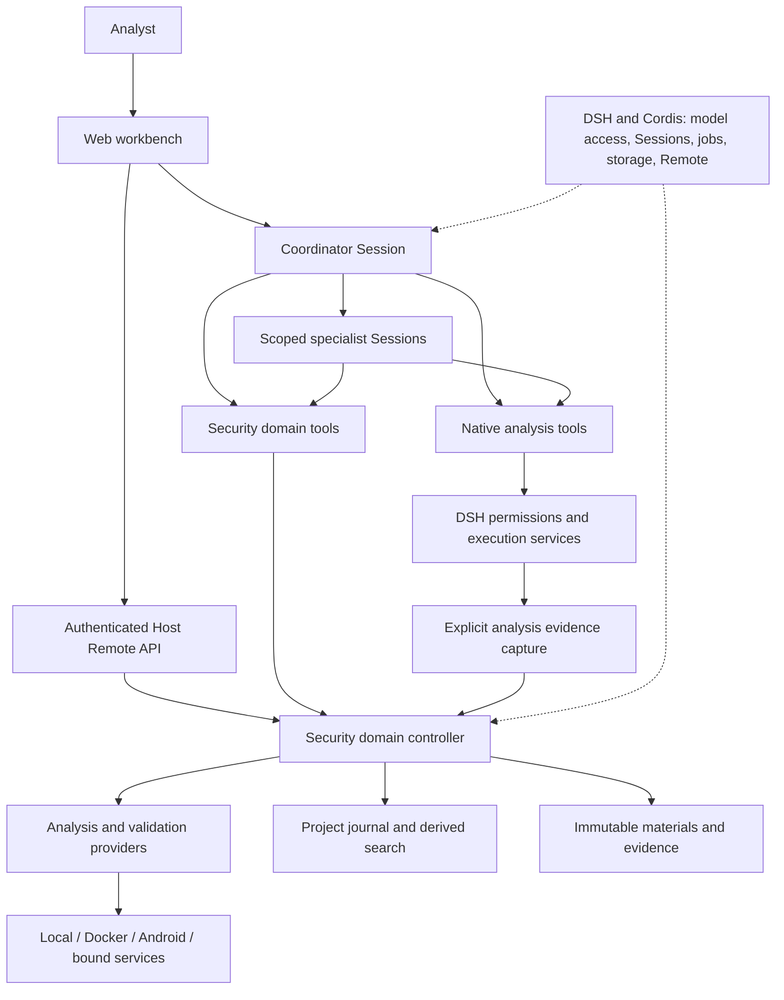
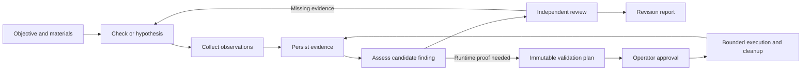

# Security research workbench: high-level design

English | [中文](security-architecture.zh.md)

## Summary

The workbench helps analysts investigate security questions across source code, binaries, firmware, Android applications and captured traffic. It combines agent collaboration with persistent evidence, independent review and operator-controlled validation. This reference describes the current design; the [capability reference](../packages/experimental/security-analysis/README.md) owns operational details and limitations, and the [roadmap](roadmaps/security-analysis.md) owns planned work.

The project builds a security research product on the general-purpose [DSH architecture](architecture.md). DSH and Cordis provide the runtime; security plugins own investigation semantics and the workbench. The security composition extends the existing agent loop.

## Table of Contents

- [Design principles](#design-principles)
- [System composition](#composition)
- [Investigation and evidence flow](#checks-and-evidence)
- [Roles and authority](#roles-and-authority)
- [Data ownership](#data-ownership)
- [Execution and recovery](#execution-and-recovery)
- [Extension points](#extension-points)
- [Documentation baseline](#documentation-baseline)
- [Further exploration](#further-exploration)

## Design principles

The analyst needs to understand what was examined, what supports a conclusion and what remains unknown. Four principles organize the system:

- **Questions drive the work.** Select the next useful observation from the objective, materials and available tools. Reconnaissance, surface analysis, assessment and validation classify checks; they do not impose a mandatory sequence.
- **Claims retain their evidence.** Observations, hypotheses, findings and reviews are distinct records. Tool success, a version match or agreement between agents does not establish a vulnerability.
- **Authority is explicit.** Roles limit assets and tools; the operator controls dedicated validation approval and environment administration. A method skill guides analysis without granting execution permission.
- **Domain state survives conversation changes.** Project records, evidence artifacts and Session logs have separate owners. Reports describe a specific project revision and its unresolved scope.

## System composition

The security Host and Web profiles compose the product from existing runtime services and security plugins. The operator uses the workbench; agents use role-scoped tools. Both reach the same security domain controller for domain operations.

| Layer | Responsibility | Owning implementation |
|---|---|---|
| Workbench | Task intake, conversation, investigation chain, evidence, approvals and reports | [Client UI](../packages/experimental/client-ui-security-analysis/README.md) |
| Agent coordination | Role prompts, scoped child Sessions, method selection and result integration | [Security profile](../packages/experimental/security-profile/README.md) and [role policies](../packages/experimental/security-analysis/src/workbench/roles.ts) |
| Security domain | Project scope, asset identities, checks, findings, reviews, plans and knowledge | [Security analysis](../packages/experimental/security-analysis/README.md) |
| Execution integrations | Tool adaptation, environment readiness, observations, approved validation and cleanup | Providers exported by the security-analysis package |
| Runtime foundation | Plugin lifecycle, model access, Session logs, jobs, subprocesses, storage and Host/Client communication | [DSH architecture](architecture.md) |

The [Web profile](../packages/experimental/security-web-profile/README.md) connects Host capabilities to the client. Provider exports belong to the security-analysis package rather than a separate package for each external tool. Native analysis remains a separate execution path governed by DSH permissions; its captured results enter the project evidence model.

## Investigation and evidence flow

The analyst supplies an objective, materials and selected resources. A project binds this scope to the coordinating Session. The coordinator chooses methods, examines existing evidence and collects observations needed to resolve the current question; it delegates when an independent question or review benefits from a separate Session.

Collection saves artifacts before publishing evidence references. Evidence identifies the material or target, tool invocation and completeness; bounded model responses point back to retained project data. Child Sessions return summaries, evidence references, uncertainty and next steps, while detailed interaction stays in their Session logs.

A reviewer assesses the exact finding content, including supporting and opposing evidence. Static conclusions require complete implementation evidence; runtime conclusions require completed approved validation. Editing a finding invalidates its prior review. Reports distinguish checked, unchecked and uncheckable scope and retain uncertainty. A successful check does not imply complete project coverage.

## Roles and authority

Expertise and permission are related but distinct. A role can investigate only its assigned project and assets, using its allowed tools. Domain checks enforce authority independently of what the UI displays.

| Actor | Responsibility | Authority |
|---|---|---|
| Operator | Define scope, choose environments, inspect evidence and control validation | Approve or revoke plans, administer environments, stop projects and publish reviewed knowledge |
| Coordinator | Choose checks, delegate questions and assemble conclusions | Collect observations and execute approved plans; cannot approve its own plans |
| Reconnaissance, reverse and Web analysts | Resolve assigned material-specific questions | Scoped collection and permitted native analysis tools; no further delegation, approval or environment changes |
| Researcher | Resolve public technical questions and retrieve existing evidence | Research and evidence reads; no provider or script execution |
| Reviewer | Independently assess an exact finding and its uncertainty | Read evidence and record a structured review; no collection or approval |

The security profile disables generic subagent delegation and PTC routes. Security-domain delegation creates fresh child Sessions with explicit bindings. Collecting roles retain native Shell and file tools under existing DSH permissions; the workbench's plan approval mechanism does not authorize or contain every native command.

## Data ownership

The system keeps the model's interaction history separate from the investigation's durable records. Each store answers a different question:

| Record | What it preserves | Ownership and recovery |
|---|---|---|
| Session log | What the model saw, requested and received | Existing DSH Session services |
| Project journal | Scope, checks, findings, plans, reviews and knowledge | SQLite-backed domain command journal with operation IDs and expected revisions |
| Immutable artifacts | Imported bytes, source manifests, scripts and collected outputs | Security artifact storage with measured identities and evidence references |
| Search index | Searchable projections of project data | Derived FTS data, rebuildable from domain records |
| Jobs and resource leases | Live execution and conflicting resource use | Runtime coordination; unfinished work needs reconciliation |
| Report | Findings and evidence at a particular revision | A project delivery snapshot, independent of the currently selected Session |

Knowledge extracted from previous work remains reference material, not evidence about the current target. The operator reviews publication of shared knowledge. Improvement proposals can become exported implementation tasks; they do not automatically launch a coding agent.

## Execution and recovery

Dedicated validation follows a versioned plan: target identity, operation, script, expected observation, impact, limits and cleanup are fixed before operator approval. Execution checks current authority and target identity again. Changing the script or scope requires a new plan. Revocation and project stop block new tracked execution and cancel active work.

Providers execute only in compatible configured environments. Tool discovery, installation, target readiness and authorization are separate checks. Leases serialize conflicting shared resources; source reads can run concurrently. Environment lifecycle changes reject admission while that environment has active runs.

Restart revokes approvals and marks unfinished execution for reconciliation. It does not automatically replay injection or process creation. Recorded operation IDs prevent exact command retries from executing twice. Complete crash recovery and raw-output retention across all failure paths still require acceptance work; per-operation limits do not imply a cumulative project token or cost budget.

### Web targets and laboratories

Registered Web targets bind an origin and path scope to a selected environment. Managed laboratories track owned resources and instance identities; reset changes the target instance on its next start. HTTP execution rechecks the target and does not follow redirects. Operator-owned laboratory lifecycle and provider validation remain distinct from analysis of imported HTTP evidence. The [provider reference](../packages/experimental/security-analysis/README.md#configure-analysis-providers) owns environment-specific restrictions.

### Source analysis, simulation and vulnerability research

Source snapshots retain member paths and hashes under one asset identity. Offline Python and browser validation pin scripts, source manifests, images and limits in approved plans; disposable simulation containers have no network or device access. Reports distinguish simulated behavior from observations of real devices.

Experimental CVE mining applies the same approval and evidence model to sanitizer builds and reproducer runs in managed Docker environments. The blind benchmark supports vulnerable/fixed source comparisons, but real-model end-to-end acceptance remains pending. The [capability roadmap](roadmaps/security-analysis.md) records the remaining research and acceptance work.

## Extension points

An additional security method needs a coherent path from a question to interpretable evidence. Extend asset and check definitions, provider operations, environment requirements, role policies, method guidance and evidence consumers together as applicable. An executable adapter alone does not provide a complete investigation workflow.

Keep security behavior in security plugins and reuse DSH model, Session, jobs, subprocess, storage and Remote services. Client views consume persisted domain records and authenticated Host APIs. Keep Host credentials and environment administration outside analyzed targets. Preserve the distinction between operator authority, model tool access and provider execution.

## Documentation baseline

This document and the root README use repository tag `rc0.0.2` as their code and documentation baseline, reviewed on 2026-10-13. The tag identifies a repository snapshot; it does not assert that all experimental capabilities have completed acceptance or change the DSH package versions.

For a documentation update, compare the baseline tag with the target revision, review changes to profiles, role policies, providers, domain records and the workbench, then update both languages and their pairing records. Record the next baseline tag and review date with that update. Keep existing baseline tags fixed so earlier documentation remains reproducible.

## Further exploration

- [User guide](user/guide/security-analysis.md): setup and the analyst workflow.
- [Security-analysis package](../packages/experimental/security-analysis/README.md): configuration, provider behavior and known limitations.
- [Domain reference](subsystems/security-workbench.md): persistent records and Remote APIs.
- [DSH architecture](architecture.md): runtime composition and extension mechanisms.
- [Implementation plan](roadmaps/security-harness-simplification.md) and [capability roadmap](roadmaps/security-analysis.md): planned changes and acceptance work.

## Dev Note

None.
