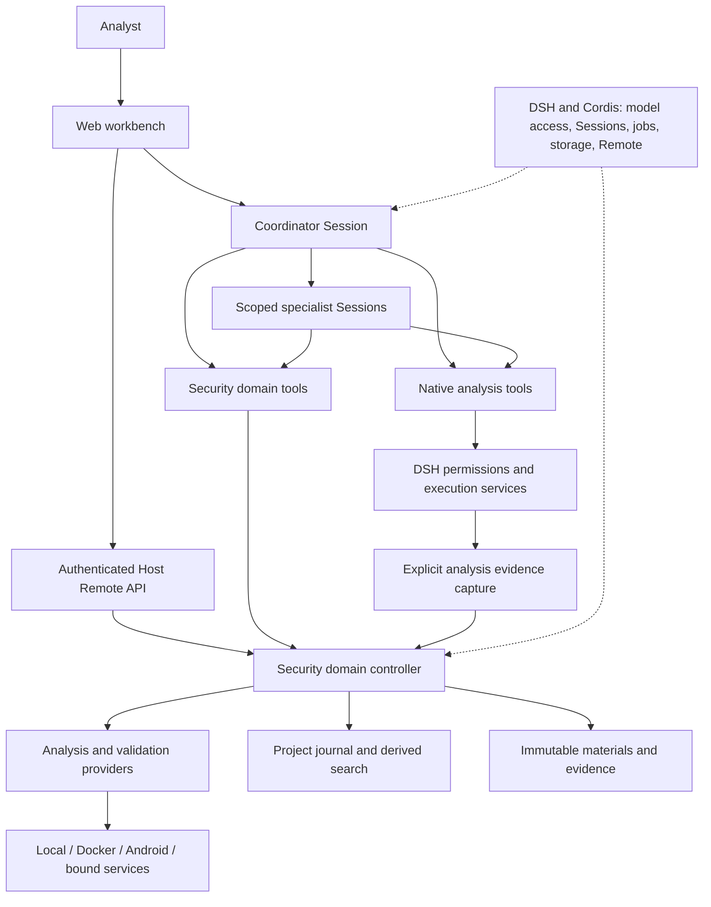
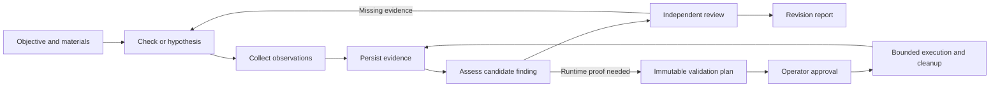

# 安全研究工作台：高层设计架构

[English](security-architecture.md) | 中文

## 摘要

工作台帮助分析者围绕源码、二进制、固件、Android 应用和抓包材料研究安全问题，将 agent（智能体）协作与持久化证据、独立复核及操作者控制的验证结合起来。本文是当前设计的架构参考；[能力参考](../packages/experimental/security-analysis/README.zh.md)维护操作细节和限制，[路线图](roadmaps/security-analysis.zh.md)维护规划中的工作。

本项目在通用 [DSH 架构](architecture.zh.md)之上构建安全研究产品。DSH 与 Cordis 提供运行时，安全插件负责调查语义和工作台。安全组合扩展现有 agent loop（智能体循环）。

## 目录

- [设计原则](#design-principles)
- [系统组成](#composition)
- [调查与证据流](#checks-and-evidence)
- [角色与权限](#roles-and-authority)
- [数据归属](#data-ownership)
- [执行与恢复](#execution-and-recovery)
- [扩展位置](#extension-points)
- [文档版本基线](#documentation-baseline)
- [进一步阅读](#further-exploration)

## 设计原则

分析者需要知道检查了什么、哪些依据支持结论，以及还有什么未知。系统围绕四条原则组织：

- **问题驱动调查。** 根据目标、材料和可用工具选择下一项有价值的观察。侦察、攻击面分析、评估和验证用于分类检查项，不构成强制执行顺序。
- **结论保留证据依据。** 观察、假设、发现和复核分别记录。工具成功、版本匹配或多个 agent 意见一致，都不能单独证明漏洞成立。
- **权限显式限定。** 角色限定资产和工具；操作者控制专用验证审批与环境管理。方法 skill（技能）指导分析，不授予执行权限。
- **领域状态独立于对话变化。** 项目记录、证据产物和 Session 日志各有归属。报告描述具体项目修订版本及其中尚未解决的范围。

## 系统组成

安全 Host 与 Web profile 将现有运行时服务和安全插件组合为产品。操作者使用工作台，agent 使用受角色约束的工具；两者的领域操作进入同一个安全领域控制器。

| 层次 | 职责 | 实现归属 |
|---|---|---|
| 工作台 | 任务创建、对话、调查链路、证据、审批和报告 | [客户端 UI](../packages/experimental/client-ui-security-analysis/README.zh.md) |
| Agent 协调 | 角色提示、限定范围的子 Session、方法选择与结果汇总 | [安全 profile](../packages/experimental/security-profile/README.zh.md)及[角色策略](../packages/experimental/security-analysis/src/workbench/roles.ts) |
| 安全领域 | 项目范围、资产身份、检查项、发现、复核、计划和知识 | [安全分析](../packages/experimental/security-analysis/README.zh.md) |
| 执行集成 | 工具适配、环境就绪检测、观察、经批准的验证和清理 | security-analysis 包导出的 provider |
| 运行时底座 | 插件生命周期、模型接入、Session 日志、jobs、子进程、存储和 Host/Client 通信 | [DSH 架构](architecture.zh.md) |

[Web profile](../packages/experimental/security-web-profile/README.zh.md)连接 Host 能力与客户端。Provider 以 security-analysis 包的导出形式提供，并非每种外部工具各有一个包。原生分析仍通过受 DSH 权限控制的独立路径执行；显式采集的结果进入项目证据模型。

## 调查与证据流

分析者提供目标、材料和选定资源，项目将该范围绑定到协调 Session。协调者选择方法、检查现有证据，并采集解决当前问题所需的观察；当独立问题或复核适合单独的 Session 时，再进行委派。

采集先保存产物，再发布证据引用。证据记录材料或目标、工具调用和完整性；有大小限制的模型响应引用保留的项目数据。子 Session 返回摘要、证据引用、不确定性和后续步骤，详细交互保留在各自的 Session 日志中。

复核者针对发现的确切内容评估支持与反对证据。静态结论需要完整的实现证据，运行时结论需要已完成且经过批准的验证。修改发现会使原有复核失效。报告区分已检查、未检查和无法检查的范围，并保留不确定性。单个检查成功不代表整个项目已完整覆盖。

## 角色与权限

专业分工与权限相互关联，但并不等同。角色只能使用允许的工具调查其获分配的项目和资产。领域检查独立于 UI 展示执行权限约束。

| 参与者 | 职责 | 权限 |
|---|---|---|
| 操作者 | 定义范围、选择环境、检查证据和控制验证 | 批准或撤销计划、管理环境、停止项目和发布审核后的知识 |
| 协调者 | 选择检查项、委派问题和汇总结论 | 采集观察并执行已批准的计划；不能自行批准计划 |
| 侦察、逆向与 Web 分析者 | 解决与指定材料有关的问题 | 在限定范围内采集并使用允许的原生分析工具；不能继续委派、审批或修改环境 |
| 研究者 | 解决公开技术问题并检索已有证据 | 研究与证据读取；不能执行 provider 或脚本 |
| 复核者 | 独立评估确切发现及其不确定性 | 读取证据并记录结构化复核；不能采集或审批 |

安全 profile 禁用通用子 agent 委派和 PTC 路径。安全领域委派创建具有显式绑定的新子 Session。采集角色保留受现有 DSH 权限控制的原生 Shell 和文件工具；工作台的计划审批机制并不授权或约束所有原生命令。

## 数据归属

系统将模型交互历史与调查的持久化记录分开保存。不同存储回答不同的问题：

| 记录 | 保留的内容 | 归属与恢复 |
|---|---|---|
| Session 日志 | 模型看到、请求和收到的内容 | 现有 DSH Session 服务 |
| 项目日志 | 范围、检查项、发现、计划、复核和知识 | 基于 SQLite 的领域命令日志，使用操作 ID 和预期修订版本 |
| 不可变产物 | 导入字节、源码清单、脚本与采集输出 | 安全产物存储，保留测量身份和证据引用 |
| 搜索索引 | 项目数据的可搜索投影 | 派生的 FTS 数据，可根据领域记录重建 |
| Jobs 与资源租约 | 正在执行的工作和资源冲突占用 | 运行时协调；未完成工作需要状态核对 |
| 报告 | 特定修订版本的发现和证据 | 项目交付快照，独立于当前选中的 Session |

从既往工作提取的知识仍是参考材料，不是当前目标的证据。操作者审核共享知识的发布。改进建议可以转为导出的实施任务，不会自动启动 coding agent（编程智能体）。

## 执行与恢复

专用验证遵循版本化计划：目标身份、操作、脚本、预期观察、影响、限制和清理方式在操作者审批前确定。执行时再次检查当前权限与目标身份。脚本或范围变化需要新计划。撤销审批和停止项目会阻止新的受跟踪执行，并取消正在进行的工作。

Provider 只在兼容且已配置的环境中执行。工具发现、安装、目标就绪和授权是不同检查。资源租约串行化存在冲突的共享资源操作，源码读取可以并发执行。环境存在活动执行时，不接纳其生命周期变更。

重启会撤销审批，并将未完成执行标记为需要状态核对；不会自动重放注入或进程创建。已记录的操作 ID 防止完全相同的命令重试重复执行。所有失败路径下的完整崩溃恢复与原始输出保留仍有待验收；单次操作限制不等于项目累计 token 或成本预算。

### Web 目标与实验室

登记的 Web 目标将 origin 和路径范围绑定到选定环境。托管实验室跟踪其拥有的资源与实例身份；重置后，下次启动会改变目标实例。HTTP 执行重新检查目标且不跟随重定向。由操作者控制的实验室生命周期和 provider 验证，与导入 HTTP 证据的分析分别处理。[Provider 参考](../packages/experimental/security-analysis/README.zh.md#configure-analysis-providers)维护各环境的具体限制。

### 源码分析、模拟与漏洞研究

源码快照在同一资产身份下保留成员路径与哈希。离线 Python 和浏览器验证在已批准的计划中固定脚本、源码清单、镜像和限制；一次性模拟容器没有网络或设备访问权限。报告区分模拟行为与真实设备观察。

实验性 CVE 挖掘将同样的审批和证据模型用于托管 Docker 环境中的 sanitizer 构建与复现运行。盲测基准支持易受攻击版本与修复版本的源码对比，但真实模型的端到端验收仍未完成。[能力路线图](roadmaps/security-analysis.zh.md)记录剩余研究与验收工作。

## 扩展位置

新增安全方法需要提供从研究问题到可解释证据的完整路径。根据需要一起扩展资产和检查定义、provider 操作、环境要求、角色策略、方法指导和证据消费方。仅有可执行适配器不足以构成完整调查流程。

安全行为保留在安全插件中，复用 DSH 的模型、Session、jobs、子进程、存储和 Remote 服务。客户端视图消费持久化领域记录与经过认证的 Host API。Host 凭据和环境管理应保留在被分析目标之外。操作者权限、模型工具访问和 provider 执行必须保持区分。

## 文档版本基线

本文与根目录 README 以仓库 tag `rc0.0.2` 为代码和文档基线，核对日期为 2026-10-13。该 tag 标识仓库快照，不表示所有实验能力均已完成验收，也不改变 DSH 包版本。

更新文档时，对比基线 tag 与目标修订版本，检查 profile、角色策略、provider、领域记录及工作台的变化，再同步修改中英文和配对记录。在同次更新中记录下一个基线 tag 与核对日期。已有基线 tag 保持固定，使旧版文档仍可复现。

## 进一步阅读

- [使用指南](user/guide/security-analysis.zh.md)：配置与分析者工作流。
- [安全分析包](../packages/experimental/security-analysis/README.zh.md)：配置、provider 行为与已知限制。
- [领域参考](subsystems/security-workbench.zh.md)：持久化记录和 Remote API。
- [DSH 架构](architecture.zh.md)：运行时组合与扩展机制。
- [实施计划](roadmaps/security-harness-simplification.zh.md)与[能力路线图](roadmaps/security-analysis.zh.md)：规划变更和验收工作。

## 开发备注

无。
