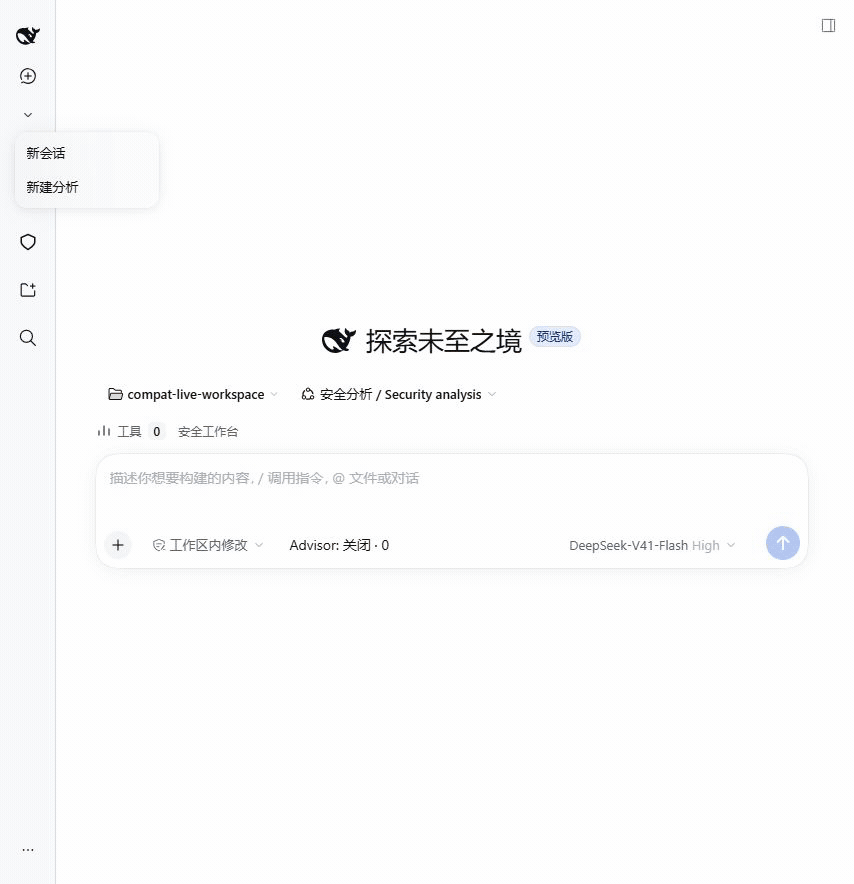
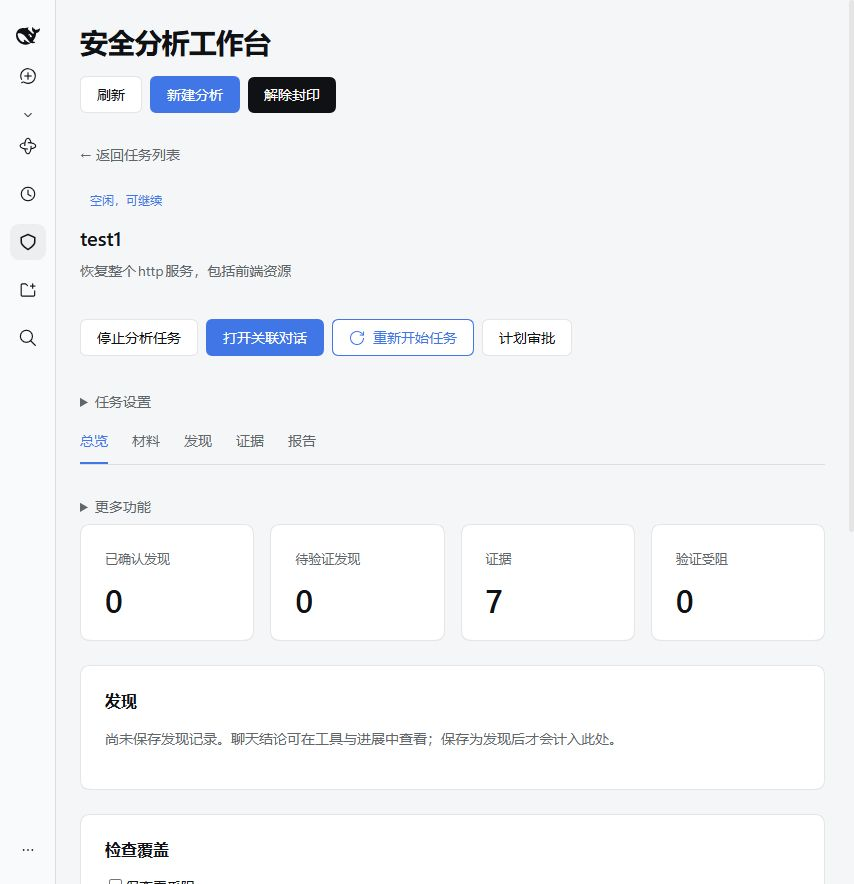
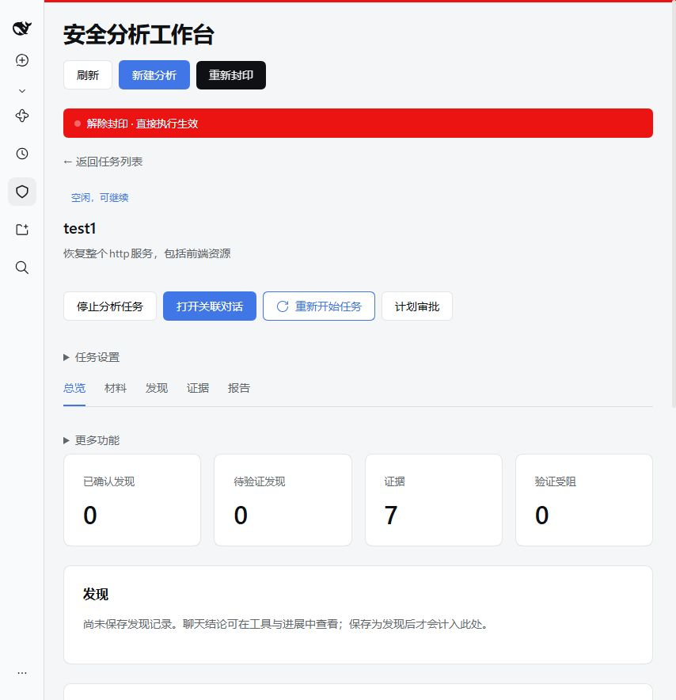

# 安全分析工作台

[English](security-analysis.md) | 中文

使用独立安全 profile 分析已授权的材料与目标。本文要求已有完成构建的源码目录、Node 和 pnpm，以及由操作者安装的所需外部分析工具。agent 工作需要 DeepSeek 模型密钥；配置模型前也可以设置项目和查看证据。完整的外部工具验收矩阵见[安全插件](../../../packages/experimental/security-analysis/README.zh.md#known-limitations-and-deferred-work)。

添加程序、网站源码、固件或抓包，也可以登记 Web 目标，然后描述要研究的问题。助手根据内容与可用环境选择并组合逆向、Web 和 IoT 方法。打开**分析工具箱**可按领域浏览工具，浏览筛选不限制任务。可在**本次会话工具偏好**指定优先工具，按需应用偏好；未保存的修改不阻止开始分析。应用前检查适配器及依赖；应用后通过专用适配器调用工具。分析进展中的**选择依据**展示已保存的方法选择理由，实际执行情况以调用记录为准。

在任务详情的**任务设置 → 分析模块**中可选择自动识别，也可手动勾选 Android/JVM、原生二进制、Web、IoT 和渗透测试。自动模式允许助手根据任务和导入材料组合模块；手动模式禁止模型修改该集合。任务详情显示已保存的选择、依据和资源目录。Android 分析支持 APK、DEX 和 JAR，原生分析覆盖 PE、ELF 和共享库。渗透测试模块（Web 亦会启用）加载 `security-kali` 方法，面向经操作者管理的 Kali 环境执行授权测试，其 playbook 与工具选型指南随技能资源发布。模块选择不会禁用 Shell 或批准目标执行；独立设置的仅适配器工具偏好仍保留既有限制。

## 1. 准备 profile

目录上传会自动将二进制成员暴露为文件资产。未保存显式绑定时，工具继承任务唯一的兼容环境。缺少依赖时在工具箱配置一次即可，不要反复复制材料或重试被拒绝的导入。旧源树快照支持 `import-member`，无需访问原 Host 路径。职责和支持差异见 [Provider 设计](../../../packages/experimental/security-analysis/README.zh.md#provider-design)。

需要复用分析方法时，打开**工具箱 → 分析脚本**。流量分析包括抓包概览和报文筛选，MQTT 包括连接时间线和主题，动态观察包括原生模块和导出函数。展开条目查看依赖、必填参数和示例。让分析助手对你的材料使用对应内置脚本，它会加载关联技能、填写参数，并将结果保存到当前任务的分析目录。动态模板仍使用现有验证计划审批流程。浏览脚本库无需选择环境，也不会安装工具。

在仓库根目录执行 `pnpm run build` 构建。源码启动器仍加载已构建的工作区插件；修改 Host 或 Client 插件后，需要先重新构建再重启，刷新页面不能替代构建。打开**安全分析 → 分析工具箱**，在工具卡片点击**配置工具**，或用**添加工具**登记自定义安装。**选择工具文件**浏览运行 DSH 的电脑上的文件，不会上传可执行文件。点击**检测**查看版本和诊断，或点击**检测并保存**在检测成功后立即应用。检测失败不会改变已保存配置。高级参数每行填写一个参数，用于解释器和自定义版本查询。**恢复默认配置**移除所选环境的覆盖项。可选择已配置的本机或托管 Docker 环境管理安装，并按需为适配工具设置**默认执行环境**。没有绑定时，适配器继承任务授权的唯一兼容环境。容器路径直接填写；文件选择器仅用于本机。在独立的 **AI 适配** 区域点击 **保存默认环境**，或点击 **恢复默认环境设置** 删除绑定覆盖；这两项操作不触发安装检测或启动容器。工具卡片分别显示安装状态、专用接口及其支持操作；检测通过不代表项目授权。配置在后续适配调用中生效，模型无需读取启动路径。适配调用固定使用所选绑定，不会回退到其它环境。也可使用下面的命令行入口。使用 Frida 时，`python` 必须安装官方 Frida bindings。工具安装情况和目标是否就绪分开检查。

```sh
pnpm security:doctor
pnpm security:doctor python unicorn radare2 tshark jadx --save
```

`pnpm security:doctor` 检查原生命令工具及 Python 模块（Unicorn、r2pipe 和 Frida），与工具箱使用同一个选定解释器。Python 诊断显示解释器路径、版本、虚拟环境、基础运行时和 pip 可用性，并区分可用安装、缺失的可选工具和失效的已保存路径。添加 `--dir "目录" --save` 可发现便携安装并保存可用路径；已保存路径失效时命令失败且不保存修改。完成后刷新工具箱。`pnpm security:tools list` 显示内置及已保存的自定义工具。工具 ID 可以扩展，使用小写字母、数字、连字符和下划线。Nmap、TShark、JADX 和 Metasploit（`msfconsole`）有内置发现项。`scan` 检查 PATH 和明确指定的搜索目录，并执行有时限的版本查询；省略工具 ID 时检查全部原生工具及目录中登记的依赖项。添加 `--dir "目录"` 可递归搜索安装目录，包括便携版 JADX。未加 `--save` 时只报告扫描结果。使用 `set 工具ID "可执行文件"` 检查并保存确切路径，或用 `remove 工具ID` 删除已保存的覆盖项。Unicorn、r2pipe 等依赖工具通过所属运行时配置。用 `python -m venv .dsh/runtimes/unicorn` 创建独立环境；Windows 上用 `.dsh/runtimes/unicorn/Scripts/python.exe -m pip install unicorn` 安装（POSIX 使用 `bin/python`），然后在 Python 卡片选择该解释器，或运行 `pnpm security:tools set python "PYTHON绝对路径"`。运行 `pnpm security:doctor python unicorn` 检查两者。Unicorn 通过 Python 脚本提供 CPU 仿真，不提供 Android 或操作系统服务。

工具箱打开时先显示目录，不自动扫描全部工具。按用途搜索或按标签、工具包筛选后，点击单个工具的 **检测** 或 **检测筛选结果**。**工具定义与导入** 支持鼠标编辑 CLI/Python 模块定义、选择 JSON 文件导入以及导出工具包；高级 JSON 可编辑集合、依赖、平台、技能引用与 provider 引用。导入先预览校验并列出冲突，覆盖需要勾选确认；保存只注册定义，不安装软件、不运行命令。定义保存在独立的 `.dsh/security-tool-packs.json`，安装路径仍在原配置文件中。

工具包使用 `{"version":1,"id":"my-tools","label":"My tools","tools":[{"id":"my-cli","label":"My CLI","commands":["my-cli"],"tags":["firmware"],"guide":"Use bounded output."}],"collections":[]}` 格式。Python 模块使用 `dependency:"python"`、`invocation:"python"` 和 `probe:{kind:"python-module",module:"import_name",distribution:"package-name"}`。依赖可以引用其它已注册工具，导入时拒绝缺失引用和循环依赖。CLI 也支持 `pnpm security:tools import pack.json`（冲突时显式加 `--replace`）、`export PACK_ID output.json`、`doctor --tag firmware`、`doctor --collection web`，以及 `--catalog FILE` 指定定义文件。

应用**本次会话工具偏好**时，会先检查所选适配器、环境绑定及已安装依赖；检查失败时自动恢复自动选择并显示原因，可直接开始分析。未保存的修改不影响已应用设置。选择生效期间模型使用专用适配器，通用 Shell 执行被禁用。需要原生工作流或没有可检查适配器的工具时，请选择**恢复自动选择**。偏好影响活跃会话及其委派子会话，在会话释放或 Host 重启时清除。

自定义工具默认用 `--version` 查询版本；在 `set` 时重复传入 `--version-arg=参数` 可覆盖。解释器可通过重复的 `--arg=参数` 为每次调用添加固定启动参数；`set` 不带 `--arg` 时清除原有启动参数。例如，将 JADX 配置为 Java 可执行文件，并传入 `--arg=-cp --arg="路径/jadx.jar" --arg=jadx.cli.JadxCLI`。Windows 的 `.cmd`、`.bat` 和 `.ps1` 启动脚本需要改为配置解释器可执行文件。这些选项用于已有安装；登记名称不会安装软件或创建专用 provider。

可执行文件路径和参数保存在当前目录下被 Git 忽略的 `.dsh/security-tools.json`。请在仓库根目录运行这些命令。`pnpm security` 与页面共用该文件，工具检查和后续模型请求会重新读取它。已保存路径失效会报错，不会回退到其他安装。脚本配置已安装软件，不修改系统 PATH。专用的 `security_radare2`、`security_r2ghidra`、`security_tshark`、`security_jadx`、`security_file`、`security_strings`、`security_readelf`、`security_objdump` 和 `security_nm` 接受已导入资产 ID 和语义参数。保存的证据支持条目分页，无需重新执行工具。已确认计数直接确定工具身份，与执行是否成功无关；从 Shell 推测的计数仍标为未验证。设备、容器及其他环境仍在[示例 overlay](../../../apps/cli/config/examples/security-analysis/cordis.yml) 中配置。`--config FILE` 用于管理其他 JSON 文件；启动器只读取默认文件。

安装设置使用以下带版本的结构；旧本机映射仍可读取，并在保存时转换。`bindings` 选择已配置的环境，`r2ghidra` 跟随 `radare2`。保存拒绝过期 revision。托管 Docker 按需启动已有镜像，不拉取镜像。

```json
{
  "version": 1,
  "installations": {
    "local": { "radare2": { "command": "/opt/radare2/bin/r2", "prefixArgs": [], "versionArgs": ["-v"] } }
  },
  "bindings": { "radare2": "local" }
}
```

<a id="external-docker-containers"></a>
### 接入已有本机或远程 Docker 容器

将[环境示例](../../../apps/cli/config/examples/security-analysis/external-container.json)复制到 `.dsh/security-environments.json`，修改容器名称和容器内工作目录。宿主 `cwd` 相对此 JSON 文件解析，因此 `".."` 表示仓库目录。`pnpm security` 按 ID 将环境合并到 profile 模板。`defaultEnvironmentIds` 为新任务选择环境；已有任务保留已保存的选择。修改环境声明后重启安全 profile。

示例使用当前 Docker context。将 Docker 安装项的 `prefixArgs` 设为 `["--context", "YOUR_CONTEXT"]`，即可选择其他已配置的 context，包括通过 SSH 或 TLS 连接的远程 daemon。宿主需要该 context 的凭据和传输程序。`externalContainer` 接入已运行的容器，不创建挂载、不启动服务、不改变网络，也不管理其生命周期。工具参数使用容器内文件系统；宿主文件不会自动上传。网络可达性由所选容器和 daemon 决定。

登记外部 Web 目标时，将运行环境选择为 `kali`。显式登记会把 Kali 加入已有任务范围，获批的 HTTP 序列通过该容器内的 Python 运行。目标 origin 与允许的 IP/CIDR 范围必须能从容器访问。凭据与响应脱敏仍由 Host 管理。Docker、容器或 Python 不可用时，计划准备会失败，不会回退到 Host 网络。

在所选容器内通过 Kali 软件包管理器安装 Metasploit。现有 `metasploit` 定义通过容器的 PATH 发现 `msfconsole`，无需绝对安装路径或单独的 DSH 插件。在仓库根目录验证已配置的环境：

```sh
pnpm security:tools doctor metasploit --environment kali
```

`available` 和 `ready` 分别表示版本检测通过和容器就绪。发现使用与本机工具相同的可扩展目录：导入其他工具包，再通过 `--environment` 选择其工具 ID。`set ID COMMAND`、`remove ID` 和 `scan --save` 管理该环境 `tools` 数组中的安装项。`--environments FILE` 为命令行操作选择其他部署文件。Web 安装文件选择器仍只浏览宿主文件。

`security_environment` 返回宿主命令和完整的 `prefixArgs`，包括 Docker context、容器和工作目录。追加工具参数即可，不要再包装一层 Docker 命令。容器停止与删除仍由操作者管理。取消检测会终止宿主 Docker 客户端，但不保证外部容器内的工作也已终止。现有角色、项目和 Shell 权限检查继续生效。远程传输已有确定性测试覆盖；实际远程部署仍需单独检查连接。

### 启动

通过现有 Web 应用加载安全组合：

```sh
pnpm security
```

在仓库根目录运行此命令。首次启动自动从 Web 模板创建 `security` profile，后续启动复用它；每次都加载安全 Host、Web 和工具配置 overlay。使用 `pnpm security --port 4081` 更换端口，使用 `pnpm security --dump-config` 查看组合而不启动服务。快捷入口仍通过原生 `dsh` profile 启动应用。

通过 DSH 打印的认证链接访问 `http://127.0.0.1:3081`。[安全 Web profile](../../../packages/experimental/security-web-profile/README.zh.md) 定义默认端口及 `--port` 覆盖方式。角色选择与安装管理见[角色和工具](../../../packages/experimental/security-analysis/README.zh.md#roles-tasks-and-tool-management)；后续工作与验收条件见[路线图](../../roadmaps/security-analysis.zh.md)。

<a id="browser-login"></a>
### 在 Web 工作流中登录网页

使用 `pnpm security --patch apps/cli/config/examples/security-analysis/browser.cordis.yml --no-open` 启用现有 Playwright MCP 集成。需要可用的 Chromium；自动发现不适用时，将 `security-browser-playwright.config.executablePath` 设为已安装的 Chrome/Chromium 程序路径。配置覆盖会替换整个 config，因此须保留 `mode: launch` 和 `headless`。需要自己在浏览器窗口输入凭据、MFA 或验证码时，设置 `headless: false`。

创建或恢复 Session，选中 Web 分析模块，让助手打开登录页、完成允许的表单操作，再继续处理登录后的页面。导航可能返回快照文件链接；`browser_snapshot` 可直接返回当前页面内容。协调者与 Web 分析员可用的操作相同，但各 Session 拥有独立浏览器和登录状态。当前活动 Session 的后续轮次保留登录；恢复、fork 或 Host 重启会创建新的浏览器状态。普通登录无需为每次点击创建验证计划；需要审批的安全验证仍走独立流程。

需要保存观察时，让助手使用匹配的资产 ID 调用 `security_capture_analysis`，先列出调用，再选择导航或快照调用。凭据输入调用无需复制到证据中；提供给模型或浏览器工具的输入仍进入普通 Session 日志。将操作记录用于验证前，请阅读[浏览器权限与证据限制](../../../packages/experimental/security-analysis/README.zh.md#tool-inventory-and-acceptance)。

## 2. 开始分析


“分析任务”把这次分析的材料、证据和报告保存在一起；报错中的“安全项目”指的就是这条记录。默认安全 profile 会在聊天首次调用安全工具时自动建立记录，即使当前工作区与启动目录不同。已退出任务的对话或显式停用自动创建的工作区需要通过下面的入口开始。

工作区已有运行配置时，可以直接从新建入口进入聊天：

1. 打开侧栏的新建类型菜单，选择**新建分析**；也可从**安全分析**工作台点击**新建分析**。工作台复用工作区已保存的环境配置并打开原生对话。需要首次配置的工作区会先显示运行环境设置。
2. 在原生输入框描述研究目标，选择模型，并按需引用文件。点击**发送消息**开始；新建任务本身不会发送模型请求。
3. 点击对话顶部或输入框旁的**安全工作台**，在右侧栏查看任务的总览、材料、发现、证据和报告。聊天保留在左侧，可继续补充要求。

下面的最简任务只请求一句回复，展示真实模型响应与聊天旁的工作台；它没有执行分析工具或验证漏洞。13 秒 GIF 按关键画面停留播放，不表示实际响应耗时，也可查看[静态截图](../../images/security-workbench/task-start-chat-sidebar.jpg)。



任务打开或运行期间，工作目录会同步到材料库；**材料**页展示同步状态及已保存内容。需要额外输入时使用**添加材料**。任务列表支持搜索与状态筛选，“空闲，可继续”不表示模型正在运行。模型自主导入仍受 `importRoots` 限制；用户明确选择材料仅授权该次导入。历史会话缺失时需要明确继续分析；停止的任务需要恢复，恢复已移除任务不会自动执行分析。

打开**任务设置 → 环境与工具**检查所选环境。缺失安装和设备断连显示为诊断。Android 设备 ID 和 Docker 镜像须在 Host overlay 中明确配置；默认示例只创建本机环境。使用 Ghidra 或设备前，请阅读 [provider 配置](../../../packages/experimental/security-analysis/README.zh.md#configure-analysis-providers)。

<a id="unseal"></a>

### 解除封印与直接执行

“解除封印”功能来源于 `dsh-purge` 插件。

解除封印为当前任务的关联会话及委派子会话启用直接执行提示词，按已登记的材料和目标处理研究请求。它是任务级设置，切换记录保存在任务日志中。

1. 从侧栏**安全分析**打开任务，或在关联聊天中点击**安全工作台**打开右侧栏。在**安全分析工作台**标题下方找到**解除封印**；鼠标悬停或键盘聚焦按钮可查看当前模式与说明。
2. 点击**解除封印**。保存期间显示**正在切换…**；成功后按钮变为**重新封印**，页面出现红色的**解除封印 · 直接执行生效**提示。刷新页面并重新打开任务后仍保留此状态。
3. 需要恢复标准模式时，点击**重新封印**。保存成功后红色提示消失，按钮恢复为**解除封印**，关联会话恢复原角色提示词。

标准模式下的任务入口：



解除封印后的任务状态：



范围内工作使用直接交付的提示方式。授权范围仍由导入样本、靶场目标及带允许地址清单的外部 HTTP 目标确定；计划、审批与证据规则继续生效。提示词替换、逐轮范围更新及部署资源的说明见[安全插件参考](../../../packages/experimental/security-analysis/README.zh.md)。

<a id="windows-wireless"></a>

### 检查 Windows 设备并分析无线抓包

打开**工具箱 → 设备**，选择本机环境并点击**检查设备**。Python、TShark、Npcap、抓包接口、nRF extcap 和串口分别显示结果。权限错误表示检查失败；安装工具或看到 COM 端口不代表具备采集能力。检查失败保留旧接口及原观测时间。通用串口不会自动认定为 Tufty，也不会打开端口。

通过**添加材料**导入自有 `.pcap` 或 `.pcapng`，在**材料**中选择 **Wi-Fi** 或 **BLE** 和本机环境，点击**分析抓包**查看汇总，或点击**查看帧**取得帧引用。已暂停任务需先恢复；缺少可访问会话的任务需先点击**继续分析**。Windows 离线分析需要 Python 和 TShark，不依赖 Docker、WSL 或专用嗅探硬件。

在**证据**中查看结构化结果，在**工具与进度**中查看执行状态。Wi-Fi 字段包括已记录的 SSID、BSSID、信道、信号强度及安全宣告；BLE 包括已记录的广播、地址、UUID 和 ATT 字段。结果区分 HCI、空口抓包和普通 IP 流量，缺失字段与加密内容保持未知。原文件保留哈希，帧号、时间戳和分析元数据关联结果与抓包；达到限制、取消或失败的结果标记为不完整。此流程不执行扫描、配对、采集、注入、刷固件，也不验证 Tufty 无线采集能力。

<a id="continuous-improvement"></a>

### 将实际观察转为源码改进

使用工作台后，打开任务的**持续改进**并选择**立即分析改进点**。系统先等待活动分析结束；安全 profile 也会在新增活动结束且静默五分钟后自动分析，期间 Host 须保持运行。这是阶段复盘，不代表安全任务完成。分析完成后可以没有值得提出的建议。失败运行显示原因，可再次请求。

打开**持续改进**对比不同任务的建议。展开一项查看问题、实际依据、期望能力和验收场景。模块名称只是调查线索，需编码 AI 检查仓库后确认。复制 Markdown 或下载任务包，交给能够访问 Harness 仓库的 Codex 或其他编码 AI。任务要求它先读 `AGENTS.md`、核实实现，再修改相应源码、脚本、工作流、提示词或技能文档并测试结果。

导入填写后的 `result.template.json`，或手动记录修改与测试结果。这会将实施声明记为**已修改**。检查改动后，由你选择**确认已验证**。不合适的建议可忽略，也可恢复。已验证建议遇到新依据时提示复查。系统不会自动启动编码工具。[配置与保留规则](../../../packages/experimental/security-analysis/README.zh.md#continuous-improvement)说明模型用量、输入限制和删除行为。

## 3. 收集并评估证据

任务详情默认打开**总览**，主要标签为**材料**、**发现**、**证据**和**报告**。展开**更多功能 → 调查链路**，可按标题查看已保存的材料、问题、子任务、观察、发现、验证计划和复核记录之间的关联。可切换到**列表**逐项阅读，窄屏初始使用此视图。可搜索问题或结果，筛选运行中或需要关注的记录，也可聚焦某个分支。相关观察默认折叠，点击**展开观察**或搜索时显示。连线只表示已保存的关联；没有关联的历史记录保持独立，缺失引用会明确提示，不补造连接。

选择发现可查看结论与成立条件，再按标题选择相关观察，即可读取原始输出。采集失败或不完整，以及静态观察、离线模拟或设备观察等方式标签仍直接显示。**技术详情**保留可复制的标识、哈希和完整记录元数据。已保存的复核反映历史判断，当前结论以发现状态为准。验证计划可打开既有的**计划审批**控制，仍需检查操作并批准具体版本。

主聊天页在输入框上方显示小型**工具**计数徽标，点击后在右侧栏打开**工具与进展**。工具卡片分别显示次数和状态徽标，时间线展示各研究方向的结论与下一步；逐次调用和证据默认折叠。进展面板只展示信息，直接在现有输入框补充或纠正分析方向，并使用原生停止按钮。另一个**安全工作台**入口打开可操作的任务侧栏，包含任务设置、解除封印和证据浏览。任务详情的**更多功能 → 工具与进展**展示同一执行时间线。未关联任务的聊天会显示提示，直到首次创建安全分析任务。

在打开任务前，可从侧栏进入**安全分析**并打开**工具箱**。选择宿主或已配置的容器，再刷新。通过链接中的说明手动安装缺失工具；刷新不会安装软件或启动 Docker。配置可执行文件路径可固定某个安装版本。r2ghidra 跟随选定的 radare2，Unicorn、r2pipe 和 Frida 跟随选定的 Python。停止的容器显示工具尚未检查；缺少可选工具不会令宿主不可用。

可要求协调者或分析子 agent 编写、编辑并执行分析脚本。生成的分析文件统一存放在所选工作区的 `.dsh/analysis/<task-session-key>/` 下：`scripts/` 放脚本，`outputs/` 放结果和日志，`tmp/` 放中间文件。每个任务和会话各有独立目录，可让 agent 告知具体路径。agent 从该目录运行脚本，用绝对路径读取原始材料。原生工具在 Windows 使用 PowerShell，在 Linux/macOS 使用 Bash；通过对应 Shell 调用 Python。使用 `job_output` 收集后台输出，再通过 `security_capture_analysis(assetId, callIds)` 保存已提交的调用标识。所得脚本分析日志可供发现、子报告和独立复核引用。它保留不完整输出，属于辅助证据，不会自动确认结论。原生脚本遵循 DSH 工作区权限、沙箱和审批；专用验证接口仍使用下述计划流程。

通过聊天要求整理样本、暴露入口及证据支持的风险假设。协调者可以委派有边界的静态问题或独立复核。子 agent 只获得指定资产；其详细 Session 可通过原生任务结果查看。重复分析前先查看原始证据并检索已有结果。

每项检查都有依赖、完成条件和支持证据，应逐项完成。委派可显式关联待检查项及输入观察，依赖未完成时不能派工。重开存在关联活动委派的检查前，须先取消委派并等待清理。填写原因重开后，依赖步骤随之重开，相关批准被撤销。中断后必须核对实际进程、设备和脚本状态才能重试。

打开**概览** → **检查覆盖**查看剩余条件、未完成依赖和关联观察。清点、实现观察、不完整或失败采集与已采纳复核分别展示，不计算安全百分比。**处理受阻**打开现有检查表单并定位记录。填写核对原因后将其改为待检查；这不会执行检查或恢复已停止项目。从调查链路、发现和依据打开源码时，显示相同的路径、行号与代码，原始输出可展开。

在**报告**中选择已保存修订，点击**导出证据包**。保留下载完成的 ZIP，并按 `SHA256SUMS` 校验文件；`manifest.json` 映射观察、脚本与文件。证据包包含完整观察（包括二进制、失败和不完整结果）、报告及快照。导入样本和源码目录默认不作为备份导出；清单列出未包含的材料。字节缺失、损坏或超过 Host 限额时失败，不生成完整归档。未压缩大小默认限制为 256 MiB；生成后续报告不会改变此修订。

通过**工具与进展**中的**分析进展**查看使用工具、当前结论和下一步或阻碍。同一问题的多轮研究合并展示，评估之后可以继续补充侦察。展开**查看调用与证据**检查执行详情，调用标识和参数保留在**技术详情**中。Shell 文本中的工具名称保持待确认，工具成功不代表安全结论成立。历史活动缺失显示为未记录，Host 重启后未完成调用的结果保持未知。工作台的**停止任务**先保存停用状态，再取消执行并等待清理。在现有输入框输入原生插话；继续已停止的分析前必须明确**恢复任务**。

协调者根据现有 Web、固件或 Android 材料选择[调查方法](../../../packages/experimental/security-analysis/README.zh.md#use-this-package)，简单问题可以自行处理。**分析进展**中的**子任务协作**显示已记录的分工、角色、执行状态和报告处理意见。展开详情可查看派工理由、完成条件、证据和不确定性，也可打开只读子会话。采纳报告用于调整计划，确认发现仍要求独立复核。缺少设备或搜索失败只留下相关待解问题，不中断无关分析。

## 4. 批准与停止验证

从任务或**调查链路**中的验证计划打开**计划审批**，检查目标、脚本、预期观察、影响、时限及清理方案；展开计划详情可查看版本哈希与参数。批准所展示的计划版本。改变目标、脚本或环境需要创建新计划，批准也会到期。**停止分析任务**阻止新操作，并取消正在执行的 provider 和委派工作。恢复不会自动重放未完成的注入或进程创建。

区分疑似、已验证、已反驳和证据不足的发现。工具执行成功本身不代表存在漏洞。共享经验需要操作者审核，始终作为参考材料，不能直接成为项目证据。

## 没有 Android 设备时如何验证

安全 profile 保留 DSH 聊天界面，在消息输入框上方增加**安全分析**入口。选择工作区并打开 Session 后，首条消息发送前即可看到入口。如果没有显示，请确认打开的是 `pnpm security` 输出的 3081 端口认证链接，构建更新后的客户端包并重启，再刷新浏览器。

1. 打开工作台，展开**高级设置与历史任务**并创建名为 `Demo` 的项目，目标填“检查自有静态样本”，环境选 `local`。这条手动配置路径不需要模型密钥。
2. 在**高级详情** → **资产**中导入 [static-demo.txt](../../../packages/experimental/security-analysis/tests/fixtures/static-demo.txt) 的绝对路径。在 PowerShell 执行 `Resolve-Path packages/experimental/security-analysis/tests/fixtures/static-demo.txt` 可取得路径。展开资产的**技术详情**核对实测 SHA-256；这是不含可执行代码的文本测试样本，不代表真实漏洞。
3. 可选地点击**生成四阶段检查计划**，再进入**高级详情** → **检查**。模板会创建带依赖关系的四项待执行检查；研究过程中可按需要选择或修订检查。试用**停止分析任务**和**恢复分析任务**，刷新后状态应保留。
4. 进入**高级详情** → **环境与工具**检查 `local`。外部工具缺失时应明确显示诊断；这不影响内置二进制 provider 读取已导入样本。
5. 配置模型后，在聊天中发送以下要求。通过实际工具卡片和证据 ID 核实调用，不能只看模型声称“已调用”的文字。

```text
Read security_scope and security_capabilities. For the imported static-demo.txt asset, use security_static with provider binary, operation strings and parameters {}. Do not run external tools or dynamic validation. Report the sample SHA-256, the saved evidence ID and the observed DSH_SECURITY_DEMO_V1 and DEMO_PARSER_ENTRY strings. Do not infer a vulnerability from this fixture.
```

在**高级详情** → **知识**中搜索 `DEMO_PARSER_ENTRY`，应能找到采集的项目证据并查看原始制品。验证委派时，让协调者把同一资产的清点交给 `reconnaissance`，任务为 `inventory`，收取 `job_output` 后，再交给 `reviewer` 以 `review` 任务复核证据。结果应包含子 Session 链接、证据引用和不确定性；子 agent 不能执行或批准验证计划。

Ghidra GUI 分析、JADX 和 Frida 需要配置对应外部工具。仅配置 Python 可执行文件不能证明 Frida bindings 或设备已经就绪。上述步骤不需要 Android 设备，通过它们也不代表外部工具验收矩阵已完成。

## 当前验收限制

Windows Frida 的正常结束和取消，以及 Docker 生命周期已有本地真实集成测试。目前没有 Android 设备可供验收。Ghidra GUI 集成、源码／二进制／Web 的全面分析及真实模型 Web 录制仍需外部环境。包 README 记录剩余实现限制；当前实验版本不表示完整计划已通过发布验收。

<a id="local-web-laboratory"></a>
## 本地 Web 靶场

侧栏的 **安全分析** 入口可独立于当前聊天访问持久项目。先在聊天工作台创建项目，再到侧栏选择它。**工具箱与靶场** 提供显式构建、启动、核对、停止和清空操作。构建会生成新镜像并下载软件包，可能持续数分钟，不会升级已有项目使用的镜像。

1. 确保 Docker Desktop 引擎已运行，Host PATH 包含 Docker CLI 和凭据助手。选择 **复用本地 Kali 镜像**，检测已安装的 `vxcontrol/kali-linux:latest`，无需重新构建或拉取该镜像。Host 靶场配置 `existingImage` 可指定其他本地镜像。登记固定不可变镜像 ID，记录工具版本和固定 yescrypt 向量的实测结果；可选工具缺失或 yescrypt 检测失败不阻塞 HTTP 采集。**构建新工具箱与靶场配方** 仍可生成官方 Kali 新镜像，该构建要求 yescrypt 检测通过。每次登记或构建产生独立版本，标签或配置变化不会改变已有靶场。准备期间可能下载固定版本的 Juice Shop 靶机镜像。
2. 启动已准备的靶场，再核对状态。严格隔离网络不支持直接发布浏览器端口，受控回环代理尚待实现。工具容器和靶机使用专属内部网络。清空会移除容器和网络；再次启动将产生新的目标标识。
3. 返回聊天工作台并刷新。在 **高级详情** → **资产** 中选择靶场环境，填写 Web 目标名称和允许的路径前缀（初次可用 /），登记已启动目标。重置后须重新登记。
4. 添加检查并准备计划：provider 为 web，operation 为 request，parameters 为 {"path":"/","method":"GET"}。填写假设、预期响应、持续时间、影响和清理说明，核对并批准具体版本后执行。HTTP 采集支持 GET 和 HEAD；记录重定向但不跟随。
5. 根据已保存证据记录疑似发现。请协调者委派新的 reviewer 子 Session 复核；复核者调用 security_review，提交发现哈希、`basis`（`static` 或 `runtime`）、支持/反对证据和不确定性。在 **高级详情** → **独立复核** 页面应用结论。静态结论须有完整的实现材料；运行验证结论须有已完成批准计划的完整证据。修改发现会使复核失效。
6. 使用会话模型或配置的专用模型，在 **报告** 页面生成报告。项目侧栏保留简短 Markdown 报告、完整 JSON 和可选的补充发现附表。正文概括安全判断、修复、可复用经验与未覆盖范围。输入或输出超出配置限额时，不会发布新报告。分析预算默认不计重复的缓存读取。接近探索限额时，DSH 会要求给出阶段总结，说明已保存的结果和未完成检查。可沿着下一项具体行动继续使用这些结果；阶段总结不代表调查已完成。

Nuclei 与 Metasploit 专用 provider 执行、审核模块目录、Vulhub 编排及通过这些 provider 访问任意外部目标尚不可用。配方安装其二进制不代表 provider 能力已可用。John provider 仅进行固定能力检测，离线密码审计后续实现。构建失败时查看记录的错误，先停止已拥有资源再重试。Host 重启将未完成靶场标为待核对，不会重放检查。

<a id="cve-blind-rediscovery"></a>
## CVE 盲测复现基准

挖掘环境在受管 Docker 容器内用 sanitizer 重编译导入的 C/C++ 源码并运行复现程序。配置一个镜像内含构建工具链的 Docker 环境（包内 toolbox 配方安装 git、cmake、make、gcc、clang 和 pkg-config），在 `environments[].tools` 下注册这些工具，并上调 `maxDurationMs` 使完整 sanitizer 构建能放入一次审批计划。

该能力为实验性且仅限手动：对话不会自动启动挖掘，工具箱只在折叠卡片中展示。`pnpm security:cve-bench prepare` 将每个种子案例固定的漏洞与修复 commit 克隆到 `.dsh/cve-bench/`，写出 `patch.diff` 作为唯一线索，并生成盲测任务与 overlay。`pnpm security:cve-bench run` 打印精确的 profile 启动命令；启动后把生成的任务粘贴进会话，检查计划步骤后批准 mining 计划，并导出报告。`pnpm security:cve-bench grade --case <id> --report <report.json>` 按案例的补丁文件与崩溃特征对导出评分。任务全程看不到 CVE 编号或公告文字；复现标准是同一 PoC 在漏洞构建上触发 sanitizer 崩溃而修复构建正常结束。把包含固定 commit 与评分字段的 JSON 放入 `resources/cve-cases/` 即可新增案例。

## 源码与静态前端项目

在**高级详情** → **资产**中导入已授权的源码文件或目录。选择单个文件时仅导入该文件。选择环境后可清点文件、从指定行读取相对路径或搜索字面文本。证据预览包含成员哈希、行号及续读位置；修改原始源码不会改变已导入快照。

设备应用应分别委派前端与设备逻辑问题。Web Bluetooth 和 GATT 应按设备协议分析，不能假定存在 HTTP 服务。让 DSH 生成注入假时钟、存储、WLAN 或 GATT 的 Python 或浏览器脚本，审批前检查具体脚本与固定镜像。镜像或运行时缺失属于能力阻塞。

项目记录保留通过的断言、失败、跳过场景和模拟假设；只有它们改变安全判断或造成重要覆盖缺口时才写进简报。独立 reviewer 必须读取原始证据，子任务摘要不能单独确立发现。依赖硬件的判断应保留待验证，直至另行授权设备测试。Ghidra 能力检查可独立延期，不影响源码分析。
