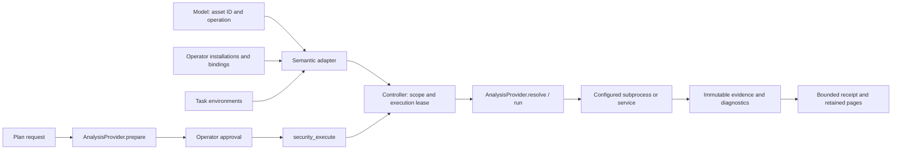

# @deepseek-ai/dsh-experimental-security-analysis

English | [中文](README.zh.md)

## Summary

Investigate owned source, binary and Web targets with independent providers and reviewer-bound conclusions. Select checks and validation depth from the security question rather than a fixed sequence. Operators approve execution plans, and tools check authority again at execution. The human report is a short security brief; original evidence remains available for deeper analysis.

## Table of Contents

- [Use this package](#use-this-package)
- [Understand the implementation](#understand-the-implementation)
- [Further Exploration](#further-exploration)
- [Model Experience](#model-experience)
- [Known Limitations and Deferred Work](#known-limitations-and-deferred-work)

Authenticated operator material imports accept pasted UTF-8 text, uploaded files and folders, or an explicitly selected Host file or directory. Host selections authorize only that import; model tools remain restricted to configured import roots. All imports use immutable artifacts and configured byte and entry limits. The operator import Remote also accepts an initial task without materials and explicit configured environment IDs; this creates the task without saving workspace defaults. After a second confirmation click, operator permanent deletion submits the archived task ID and displayed revision. It scrubs task records from historical commits, removes activity and unshared stored artifacts, and rebuilds search; interrupted cleanup resumes on reopen. Shared artifact references, original materials, workspace files and independent chats remain. Owned laboratories must be stopped or reset before permanent deletion. Summaries and reports use Simplified Chinese with identifiers and paths preserved. Project removal is reversible: it stops execution, deactivates project bindings and hides the project from active selection; restoration retains the stopped state and does not reattach Sessions. Operator-only projectSessions returns active coordinator references; the client filters them through its accessible, unarchived Session directory. projectArtifact validates ownership against the selected project before performing the existing digest-verified, output-limited read. projectMaterial lists immediate snapshot children in bounded pages and previews a selected member as text, a raster image or a binary prefix. Asset membership authorizes every read; preview paths never resolve against the live filesystem. These reads neither open Sessions nor alter bindings or persisted records.

Tasks optionally persist `moduleSelection` with `mode`, `modules` and `reason`. Missing selections resolve to automatic mode with common investigation capabilities. The coordinator selects `reverse.android`, `reverse.native`, `web`, `iot` or `pentest` through the revision-checked `modules` action; manual selections are operator-owned. `web` and `pentest` both enable the `security-kali` penetration-testing method; reverse modules gain no Kali associations. Active specialist skills are registered per Agent and their bodies load on demand. Module selection constrains dedicated tools and generic provider observations without granting roles or execution approval. Unknown files use common identity inspection before selection. Read imported materials with `security_scope` kind `asset` and task records with kind `engagement`; unknown kinds are rejected instead of returning empty pages.

`security_apk inventory` lists bounded APK members; `security_jadx manifest` parses ordinary XML decoded by JADX. `security_analysis` runs fixed Android fingerprint, API, Kotlin name and native-triage transformations over saved same-asset adapter evidence. It accepts evidence IDs, not executable paths. Healthy adapters run directly; missing dependencies are configured in the same environment before returning to the adapter. Unsupported operations may use existing scripts or Shell subject to tool preferences. Kotlin candidates never rename samples; partial decompilation preserves its failure and incomplete status. See the [adaptation review](resources/skills/sources.md) for upstream versions and exclusions.

`security_jadx callgraph` uses JADX's `--call-graph json` and JSON method output. It retains exact method descriptors and source locations; the upstream graph excludes unresolved external calls and does not supply call-site offsets. `security_analysis android-callchain` and `native-xref-paths` accept saved evidence IDs, an exact method descriptor or hexadecimal seed, `direction` (`callers`/`callees`) and positive `maxDepth`. Native paths consume radare2 function ranges and references, distinguishing calls, jumps and data references. Results retain evidence for each edge, cycles, missing-evidence frontiers and collection limits; they describe one discovery path per node, not all paths or runtime reachability. No graph operation runs a target or accepts a command.

The operator `skillUsage` read folds committed skill catalogs, successful model reads, explicit user injections and failed reads across historical task bindings. Rows include Session IDs, instruction-render hashes and event positions. Fork prefixes are excluded; reload does not increment counts. Missing logs and ambiguous historical task attribution remain visible. Task-context messages record task identity even without extra context. Skill reads do not prove compliance, and no tool or finding is attributed to a skill merely because it ran afterwards.

`projectMaterialDocument` authorizes a project asset and its exact snapshot member, returning immutable text, raster, PDF or binary-prefix content with its artifact digest. Office conversion uses the optional `officeToPdf` service with deferred bounded reads. It accepts no Host path, exposes no write operation and does not create a Session.

-----

## Use this package

`environmentConfigurationPath` is an optional absolute path to operator JSON. Environments in that file replace same-ID deployment declarations; other environments remain. Relative `cwd` values resolve beside the JSON file. An absent file contributes nothing, and invalid declarations fail startup. Optional `defaultEnvironmentIds` replace intake defaults only when `taskIntake` is configured. The file does not change budgets, evolution settings, data roots or tool installation files. Environment-provider reload drains its own operations and owned containers; it keeps the workbench, reports and other environments available. Full workbench disposal cancels owned jobs and saves their final activity before closing storage. The read-only `followSessionView` Remote takes an authorized `sessionId` and does not activate an Agent.

Optional `taskContext` contains `background` and an independently optional `authorization` declaration (`basis`, `scope`, `allowedActions`, `restrictions`, optional epoch-millisecond `expiresAt`). The four text fields are required only when authorization is enabled. Declarations are user statements, not verified permission; they neither register assets nor replace execution approvals, roles, expiry or attempt checks. Old tasks without the field remain unchanged.

Workspace resource settings save defaults; new tasks copy them into their own snapshot. Creation omits `taskContext` to inherit defaults or sends `null` to opt out. Updates omit it to preserve the saved value or send `null` to clear it. Only authenticated operator interfaces edit declarations. The complete rendered snapshot must fit `taskContextMaxBytes` (default 4096 UTF-8 bytes); oversized input rejects without truncation or a model call.

The security plugin logs snapshots as `user/message` with source `security-task-context`. A Session projection retains the latest snapshot and whether compaction removed it. Unchanged retained context is not appended for progress or revision updates; edits, expiry, clearing, task switches and removal by compaction produce a replacement snapshot. Security-preset first-send preparation copies workspace defaults before prompt admission. Historical snapshots still consume input tokens, and the model may ask about missing, conflicting or out-of-scope details.

Use [security-profile](../security-profile/README.md) in a dedicated `dsh` profile. Add [security-web-profile](../security-web-profile/README.md) for the conversation workbench. The default general profiles do not load these bundles.

Analysis supports reverse engineering, Web and IoT. The Agent chooses and combines methods from the objective, observed material contents and available environment; session tool preferences select checked adapters. `security_scope` asset summaries project the saved `assetKind`, file `format` or Web `origin`, `pathPrefix` and `environmentId`. Unknown files can use built-in `binary.identity`; `header.packetCapture` observes PCAP/PCAPNG magic without asserting packet validity. Source directories require listing and targeted reads; binary members that the available tools cannot inspect need separate file imports. `security_capabilities` includes skill references in brief tool results and offers overlapping `reverse`, `iot` and `pentest` collections alongside existing collections. Check only the external tools needed for the question. Record concise material-based selection reasons in `checkpoint.reason`, observations in `summary` and follow-up work in `next`; recorded calls and evidence establish actual execution. These projections and observations use existing records and logged tool results.

Load `security-investigation` through the ordinary `skill` tool, then combine `security-web`, `security-firmware`, `security-android`, `security-iot-offline`, `security-kali` and `security-cve-mining` as the materials and question require. These [methods](src/methods.ts) guide evidence-driven hypotheses, distinguishing checks, tool selection and bounded delegation. Exhaustive authentication requests use existing checks to record the sample and entry-point scope, evidence and unresolved questions. Reports distinguish checked, unchecked and uncheckable scope without turning normal authentication into vulnerability findings. Web work follows identities, inputs and handlers; firmware work connects extracted components to reachable consumers; Android work distinguishes APK/DEX/JAR inspection from observations on an explicitly selected adb device. Missing device access leaves device behavior unverified without blocking useful static work. `security-kali` orchestrates authorized penetration-testing engagements through operator-managed Kali environments: its [entry body](resources/skills/kali.md) selects scenario playbooks and tool-selection guides from [resources/skills/kali/](resources/skills/kali/), enforces scope-first risk gates and routes binary questions back to the reverse modules. Skills can bootstrap missing dependencies on demand through the existing Shell and permission workflow; loading a skill does not install tools or grant permissions: existing role checks, project scope and execution approval remain authoritative.

1. Describe the task in the Web conversation for a configured workspace, or create a project with its objective and configured environments. Import PE, ELF, APK, DEX or JAR files, or an immutable source file or directory, from the deployment’s `importRoots`.
2. Choose the next analysis question and provider for each asset. APK imports measure DEX and native library members separately and retain their parent relationship.
3. Inspect environment health. Configure executable locations under `environments[].tools`; an installed tool is not proof that a target is accessible.
4. Use implementation evidence to assess hypotheses. When runtime validation is needed, prepare a plan with its target, script, observations, impact, duration and cleanup policy.
5. Inspect and approve the immutable plan in the workbench. Stop or revoke blocks new execution and waits for active provider cleanup. Reconcile interrupted checks before retrying.

The bundled [analysis script library](src/analysis-scripts.ts) keeps reusable files in `resources/analysis-scripts/{tshark,mqtt,dynamic,reverse}/`. Load `security-packet-analysis`, `security-mqtt` or `security-dynamic` for the method, absolute resource directory, parameters and examples before writing new analysis code. Offline Python scripts use an explicitly selected TShark executable to read pcap/pcapng files, preserve MQTT PDU boundaries and reassembly, and return bounded JSON with input/script hashes, tool version, parameters and incompleteness reasons. Time, frame, decoded-byte and result-byte limits are required arguments. Output paths are absolute and must be new; results belong in the task's `outputs/`. Dynamic `prepare.py` writes parameterized JavaScript into the task's `scripts/` for the existing immutable Frida validation plan; it never attaches to a process. Templates observe native modules or exported functions, and event limits mark evidence incomplete. Bundled resources remain unchanged. These scripts run on the native Host; online MQTT, Android Java templates and custom-directory imports are not provided. `scriptCatalog` exposes read-only browsing without a selected project or environment.

`security-native` links an on-demand [PE helper](resources/skills/pe.md) for batch VA/RVA/file-offset conversion and explicit equal-length patch manifests. It requires `pefile` in the selected Host Python. Patches check the input hash, expected bytes and nonoverlapping mapped ranges before creating a new output directory, then derive the PE checksum and save a detailed report. A compact receipt lets subsequent work reuse the result without repeating evidence collection. Byte checks do not establish calling-convention or runtime correctness; existing adapters supply xrefs.

Automatic Web task intake first uses saved conversation-and-workspace settings, then operator-saved workspace resources, exact `taskIntake.workspaces` entries (`cwd`, `environmentIds`), or `taskIntake.defaultEnvironmentIds` for unmapped workspaces, in that order. `taskIntake.maxAttempts` supplies the attempt limit. The selected `security` preset creates and associates one workspace task before the first authenticated prompt is queued; missing or unavailable environments and a missing attempt limit reject without a model call. Repeated preparation reuses the association. Ordinary presets do not create tasks. Each task fixes its workspace root, environment IDs, attempt limit and optional context at creation. Missing or expired authorization stays missing or expired, and URL mentions register no targets. Each workspace has one lightweight target; native file tools read source on demand. Internal messages and delegated Sessions cannot initialize tasks; existing and explicitly left bindings are preserved. The security profile selects `local` for unmapped workspaces. CLI entry uses explicit project creation. Legacy compositions without a registered preset projection retain tool-triggered intake and literal-IP target registration; new preset conversations do not use that path. Creation grants no execution approval.

First-message settings persist by Session and workspace in `security_workspace_intake_v2`, independently of workspace defaults. Configuration saves and first-send creation serialize per Session; saves reject after association. A null override restores workspace defaults without changing the preset. Creation copies the selected mode, modules and context; restart copies the current task. The previous workspace-intake domain is not imported.

Workspace tasks retain a fixed source directory, a lightweight workspace target and primary Session identity. Creating, opening and resuming a task never scans or copies its source tree. Native read, glob, grep and shell tools operate under existing DSH permissions. Explicit imports and historical source snapshots retain their immutable bytes. The task browser opens the native workspace files view; no background material observer is created.

The operator can also use `/security` to inspect state or `/security <JSON command>` to submit the same revision-checked commands. `security_help` accepts an optional `action` to return only that command schema; omitting it returns the complete schema. Static collection receipts include the current revision for subsequent commands; concurrent changes still require a refresh. Models cannot create operator approval or publish shared knowledge. A normal command must carry a stable operation ID and the observed revision; stop and revoke accept stale revisions because they only reduce execution authority.

Dedicated read-only tools accept an imported file assetId and semantic parameters; the [adapter catalog](src/tool-adapter-catalog.ts) defines their operations. They call controller.observe through AnalysisProvider, preserving roles, project scope, leases and evidence. Models provide no executable or environment ID. security_r2ghidra follows radare2. Ghidra queries, ADB device/package queries and offline Wi-Fi/BLE analysis use their existing providers. See [Provider design](#provider-design) for configuration and environment support; Shell and security_static remain available.

For adapted tools, security_capabilities exposes the dedicated interface and operations. Select toolIds, details and native: true to load existing advanced workflows for uncovered operations or unsupported environments. security_environment omits adapted launchers by default; native: true returns measured launch configuration, and external-container inventories always retain it. Operator inventory keeps full installation details. Imported definitions cannot replace the default semantic interface. Existing Provider and Shell workflows remain available without silently changing execution environments.

Configure installations and optional fixed environments in Toolbox. toolConfiguration.path stores version 1 JSON: installations is keyed by environment ID then tool ID, and bindings maps adapter binding IDs to environment IDs. Each installation contains command, prefixArgs and versionArgs. toolConfiguration.environmentId identifies the local owner of legacy flat files; the first save writes the versioned format. Deployment environments[].tools and toolAdapters.bindings supply defaults. Unbound adapters inherit the task's unique compatible environment. Saves compare revisions and replace the file atomically; failed probes leave it unchanged. In-flight operations retain their installation snapshot.

Deployment installations and bindings work without toolConfiguration; the optional file enables operator edits. Bind and reset-binding update only routes. Installation checks search PATH, Git's adjacent Windows utility directories, the local environment provider's configured `searchDirectories`, and the selected local environment's `discovery.searchDirs`. A unique verified local installation is saved when the configuration is writable and unchanged; multiple candidates require operator selection. Explicit installations never fall back to a different command. Python modules are checked in the selected interpreter. Discovery neither installs software nor selects an analysis method: adapters expose capabilities, skills guide methods, and the model makes the final choice. Tool-specific environment variables and nonempty searchPaths are not configuration inputs; empty legacy searchPaths remain readable.

Restart archives a task round and creates new project and Session identities. It retains the current task's objective, context, materials, environments, attempt limit, manual module selections, seal mode, effective preset, model, Advisor availability and mode, and durable tool preferences, but excludes conversation history, evidence, findings, reports, derived knowledge and execution approvals. Workspace default changes do not apply, and authorization expiry is not renewed. Missing environments reject before stopping the old task. Local materials with recorded origins are reread; uploads retain their saved bytes. Legacy materials require explicit confirmation to reuse saved content or a replacement path, never filename-based path inference. Source imports exclude `.dsh/analysis`. Existing workspace files and historical records remain intact. The fresh conversation waits for a user message; retrying the same restart returns its reserved destination. Managed laboratory targets must be recreated before restarting.

Managed Docker detection and static adapter execution start the configured existing image under the environment lease; they never pull images. Docker installations name container executables, while docker names the Host launcher. Inputs and generated files use private run directories mounted under /dsh-inputs and are removed after execution. These static adapters do not support external containers, Android devices or SSH; ADB has its own device route. Configuration and detection do not install or update software.

The toolAdapters limits maxItems, maxInstructions, maxPackets and graceMs default to 1000, 200, 1000 and 3000. Collection also obeys maxDurationMs and maxOutputBytes; modelResultBytes bounds each complete response. Outputs preserve semantic items, addresses or source locations, bounded raw output, diagnostics and completeness. security_evidence(evidenceId, itemOffset, itemLimit) reads retained items without rerunning; byte pagination reads original retained diagnostics. Reaching the packet limit or applying a display filter conservatively marks the result incomplete. Empty successful output, decoding failure, partial decompilation, truncation, timeout and cancellation remain distinct.

Adapter activity records use provider-defined tool identities and sessionId plus callId deduplication. Version detection, launcher processes, evidence reads and result recovery add no analysis executions. Evidence commits attach to their activity records idempotently. Confirmed means known tool identity, regardless of success; legacy Shell guesses remain unverified and historical rows retain their original values. Counts are grouped by research direction and Session, separately from normal chat tool counts.

### Configure analysis providers

The package exports separate `./native`, `./offline`, `./web`, `./external-web`, `./laboratory`, `./environment`, `./ghidra`, `./frida`, `./android`, `./mining` and `./commands` plugins. The [configuration source](src/index.ts) owns artifact, output, duration, approval lifetime and delegation limits. Only configured local, Docker and Android environments are eligible. Docker control remains on the Host.

A Docker environment with `externalContainer: { name, workdir }` uses that existing container instead of an `image`; the fields cannot be combined. `workdir` is an absolute container directory. The Docker installation's `prefixArgs` selects a local or remote context. External containers support inventory, native shell invocation and `external-web` requests; providers that require Host artifact staging reject them. Their lifecycle and network settings remain operator-owned; DSH does not mount Host files or stop the container on cancellation or disposal. Cancellation joins the Host Docker client only; remote process completion remains unverified. Inventory returns a Host executable and complete launcher arguments while retaining the container installation separately. When the project registers loopback HTTP targets, a ready docker inventory also carries `targetChecks`: one measured observation per target, recording the working `reachableAs` origin when a derived candidate answers — the original origin, host-gateway names and the container's measured default gateway, probed from inside the container — and `unreachable` or `unknown` otherwise, never a guessed address. A local environment may declare `discovery: { searchDirs }` with absolute Host directories; catalog tools without an explicit declaration are then also searched there during inventory. The [deployment guide](../../../docs/user/guide/security-analysis.md#external-docker-containers) describes configuration and CLI management.

[GhidraMCP 1.4](https://github.com/LaurieWired/GhidraMCP/tree/1.4) requires the [managed patch](resources/ghidra/patch_upstream.py). Apply it to the pinned upstream Java file, build the extension against the corresponding Ghidra distribution, and open the imported program in the GUI. Set `DSH_GHIDRA_TOKEN`, `DSH_GHIDRA_SHA256` `DSH_GHIDRA_PROGRAM` and `DSH_GHIDRA_PORT` before launch; port 0 selects an available port. Optional `DSH_GHIDRA_READY` names a new file that receives the actual port. Configure the same token, measured hash and domain-file path under the Ghidra provider's `programs`. The patch binds a stable program, listens on loopback, authenticates every request and refuses a closed or mismatched program. GUI selection does not retarget queries. Queries, rename, comment and prototype operations use the dedicated adapter; database writes require a plan.

Frida uses official Python bindings through Harness subprocess. Configure a Python installation that contains Frida. Attach requests identify PID, name and start identity; the helper also verifies the executable hash or Android package identity. Custom scripts and spawn require a validation check. The helper unloads and detaches; it terminates only processes it spawned. A configured, hashed Java bridge bundle can be prepended before approval using `javaBridge: true`; [the entry source](resources/java_bridge_entry.js) must be bundled with `frida-compile` and `frida-java-bridge` before configuring its path, hash and version. The approved artifact contains the final script bytes.

JADX accepts APK/DEX assets and reports incomplete decompilation explicitly. adb operations select a configured device and expose only fixed package/device queries. Android validation verifies the installed base APK before instrumentation. Root, Frida server/Gadget, USB authorization and compatible versions remain operator prerequisites. Register `fastboot` and `john` with version arguments to inspect installation; no execution provider exposes their device-writing or audit operations.

### Tool inventory and acceptance

Playwright MCP tools support interactive Web workflows, including form login, navigation and repeated use of the same live Session's cookies. With the Web module selected, the coordinator and Web analyst can use the explicit page-operation catalog; other roles cannot execute it. Arbitrary JavaScript, uploads, browser installation and unrecognized upstream tools are excluded. Tools remain subject to the execution guard even when called without model schema discovery. See the [login setup](../../../docs/user/guide/security-analysis.md#browser-login).

Browser calls contribute verified Playwright invocation counts and respond to project cancellation. Use `security_capture_analysis` to list committed calls and save selected observations against an assigned asset; activity entries link to the resulting immutable evidence. Capture retains logged text and attachment references without reading browser output files. Evidence remains auxiliary and incomplete, with analyst-declared target association; it does not approve validation or establish a vulnerability. Form values and page content follow ordinary Session logging, so enter sensitive credentials manually in a headed browser when they must stay out of model/tool inputs. Browser traffic uses the Host network, independently of `external-web` origin/IP enforcement and credential storage.

Host and CLI tool checks share executable discovery, dependency ordering and probe decoding. Discovery continues only when a candidate executable is absent. A selected executable's failed query, timeout, empty response or invalid JSON reports an error without trying another installation; failed checks do not save configuration. Python identities include interpreter location, environment prefixes and pip availability.

| Tool | Operations and impact | Execution and cleanup | Verified combination |
|---|---|---|---|
| Built-in binary | Measured identity, bounded hex and ASCII/UTF-16LE strings | Immutable artifact reads; bounded output, no target execution | PE/ELF headers and byte-page fixtures |
| GhidraMCP 1.4 | Bound program queries; database writes require a plan | Authenticated loopback, bounded HTTP; database mutations are not replayed | Extension built against Ghidra 11.3.2; independent ARM ELF import completed; DSH queries blocked after GUI closure |
| Frida 17.18.0 | Process/module/export enumeration, trace, approved custom scripts and spawn | Python helper; configured duration/output bounds; unload, detach, stop owned processes | Windows local owned Python executable: normal completion and cancellation |
| radare2 / r2ghidra / TShark | Fixed static queries and offline captures | Bounded subprocess output and saved semantic evidence | Windows local tiny ELF identity/disassembly/decompilation and empty PCAP; container combinations unverified |
| JADX | APK/DEX decompilation and source/resource extraction | Managed subprocess; bounded output and temporary-directory cleanup | Windows local CLI with a valid empty DEX/APK; partial-source failure covered by fixtures |
| Docker 29.7.2 | Start, inspect and stop an owned environment | Exact image digest, resource limits, no network, remove owned container | Local Docker Desktop with existing offline image: concurrent-start exclusion, strings/readelf/objdump/nm over ELF, staged-file cleanup and container removal |
| adb | Selected device state, package listing/details, base APK identity read | Fixed argv through subprocess; no arbitrary shell commands | No connected Android device; unverified |
| fastboot / john | Version inventory; fixed John yescrypt acceptance in the managed toolbox | Operator queries and isolated fixture test | Device writes and password audit providers unavailable |

### Roles, tasks and tool management

The Toolbox separates shareable definitions, environment installations and measured results. `toolCatalogPath` selects an absolute JSON file containing imported version-1 packs; the source launcher uses `.dsh/security-tool-packs.json`. Packs define CLI commands, Python modules with separate import/distribution names, JSON plugin queries, existing provider references, free tags, collections, dependencies, usage guides and skill references. Import previews validate references, cycles and identity conflicts without executing commands; explicit replacement and revision checks precede atomic writes. Later queries reload definitions while in-flight probes retain their captured definitions. `toolConfiguration` selects the legacy local `environmentId` and versioned installation JSON `path`; existing `.dsh/security-tools.json` and `environments[].tools` remain supported, including custom IDs. Page installation saves require a successful bounded probe. A configured executable never silently falls back to PATH. Software installation remains manual.

| Role | Task | Available analysis capabilities |
|---|---|---|
| `coordinator` | Plan, integrate and validate | Domain tools, native scripts, web references, jobs/goal/todo, optional `advisor`; approved validation execution |
| `reconnaissance` | `inventory` | Native scripts, binary identity/hex/strings, Ghidra inventory, fixed adb queries, environment health, evidence search |
| `reverse-analyst` | `surface`, `assessment`, `mining` | Native scripts, binary inspection, read-only Ghidra queries, JADX and fixed adb queries, environment health, evidence search and public research |
| `web-analyst` | `surface`, `assessment` | Native scripts, assigned HTTP evidence, immutable source reads/search, environment health and public research |
| `researcher` | `assessment` | Project evidence, reviewed knowledge, public web search/fetch; no sample execution or static provider calls |
| `reviewer` | `review` | Assigned evidence and knowledge retrieval; no collection, web lookup or validation execution |

The role filter runs after child preset initialization, including inherited native tools and the child-scoped `structured_output` report tool. Reviewer Sessions retain their dedicated `security_review` tool.

Each child receives a fresh Session with role-specific instructions and a compatible task. The [prompt and permission definitions](src/workbench/roles.ts) require one asset, a question, completion criteria, time/output limits, evidence references, uncertainty and next steps. Role admission is checked on every tool execution and again on static collection in the domain; hiding schemas alone does not authorize operations. Children cannot delegate, execute plans, approve or publish. The coordinator submits candidate records from their reports. Research prompts exclude private sample content from public queries; network data-loss prevention is not implemented.

The coordinator keeps small or dependent questions and delegates when parallel progress, context savings or independent scrutiny justifies the handoff. Web and reverse analysts can answer small public knowledge gaps directly; `researcher` is useful for substantial independent research. `security_delegate.reason` records the expected benefit. Each assignment retains its question, completion criterion, original project and asset, research direction, child address and execution outcome. `security_scope` with `kind: "delegation"` returns bounded summaries and details; the logged runtime context reports outstanding work. The coordinator records `delegation-disposition` as `accepted`, `needs-more` or `rejected`, with a reason. Acceptance does not confirm a finding. `retryOf` links a new bounded assignment to a settled task without resuming its child.

The job owns cancellation and waits for child cleanup. A successful job-ID receipt means dispatched, not completed; valid bounded reports become completed only after cleanup. Stop and archive cancel active assignments and await settlement. On Host restart, unfinished assignments become interrupted and are not replayed. Original Session logs and evidence remain available. Historical `binding.report` summaries remain readable without invented assignment metadata; new reports belong to their delegation records.

A reviewer can inspect existing evidence before a finding exists and return a structured report with evidence references and uncertainty. That report creates neither a finding nor a recorded finding verdict. For a formal verdict, the coordinator first saves a suspected finding with evidence; the reviewer calls `security_review` with its real finding ID and current hash.

The built-in `binary` provider needs no external installation. Call `security_static` with `provider: "binary"`, the assigned asset/environment and `operation: "identity"`, `"hex"` or `"strings"`. Identity accepts parameters "{}" and reports measured SHA-256 and selected PE/ELF header fields. Select a single imported file with assetId; source snapshots and parameters.path are rejected before collection. The coordinator uses security_help(action: "import") and security_command with action.kind "import" to import the authorized absolute file path; delegated analysts request that import from the coordinator. Hex/string parameters accept byte `offset` and `length`; strings also accept `minLength` and `encoding` (`ascii` or `utf16le`, printable ASCII characters only). Omitted length is one eighth of the output budget. Partial pages retain offsets and incompleteness; overlap pages to inspect strings crossing a page edge. These observations do not establish full file validity, reachability or a vulnerability.

### Unseal direct execution

An operator can unseal a task from the button row below the task page title. While unsealed, every session bound to the task — coordinator and delegated children — shadows the harness identity and both deployment persona sections in its own scope with a direct-execution contract, so the contract opens the system prompt as the task persona. The direct-execution persona is static, keeping the system-prompt prefix cache-stable; the contract's authorized scope is enumerated separately in the `security:unsealed-scope` runtime-context entry, refreshed every turn, so importing materials or registering targets never disturbs the cached prefix. In-scope offensive work is delivered without preamble, disclaimers or defensive-only redirection, routing colloquial operator terms to workbench checks. Out-of-scope requests keep the existing scope-denial behavior; plans, approvals and evidence rules are unchanged. Sealing again or archiving removes the shadows and restores the deployment persona; toggles are journaled with the engagement and survive restarts.

The workbench reads [resources/prompts/unsealed.md](resources/prompts/unsealed.md) verbatim once per plugin instance at initialization. The package includes this Markdown resource; edits take effect after restarting the Host with the updated file. No generation step is required. An unreadable or empty resource, or one missing `AUTHORIZED SCOPE`, prevents initialization. The assembled prompt remains model-visible and session-logged.

### Evidence and recovery

`finding`, `revise-finding` and `complete-task` accept `citations` alongside saved `evidenceIds`. A source citation supplies `kind: "source"`, `path`, `startLine` and `endLine`; optional `sessionId` selects an authorized Session and optional `callId` selects an earlier read. The Host selects the latest successful single `read` that covers the entire range and saves only that recorded snippet. It never rereads the file or joins different read versions. Missing ranges and truncated lines are rejected; legacy reads without truncation metadata remain explicitly incomplete. Coordinators may cite authorized child Sessions from the same task and workspace; children may cite only their own observations. A `kind: "tool"` citation supplies `callId` and optionally `sessionId`, preserving committed tool output and its failures or limitations without asserting runtime validation. Explicit capture remains available for advanced evidence management.

Failed or cancelled observations and approved executions save available bytes and failure diagnostics before rejecting. Repeating the same operation reports its saved failure without invoking the provider again. Incomplete observations without a failure remain readable; an evidence record alone does not establish success.

`security_capture_analysis(assetId)` lists capturable call IDs from the caller's own Session without saving evidence; optional `jobId` filters collected background output, and `offset` follows the returned `nextOffset`. Commands and output bodies are omitted. Background job IDs are not call IDs. Pass the returned IDs to `security_capture_analysis(assetId, callIds)` to save committed native `bash`, `pwsh` and `job_output` events from the caller's own Session as immutable script analysis logs. Background capture includes the recorded shell start and collected output up to the selected call. Repeating the same selection returns the same evidence and links it to every matching activity record. Generated scripts need not be imported to capture these calls. Failed, truncated, spilled or unfinished results remain explicit; spill paths are not read. The asset association is analyst-declared, and logs are auxiliary evidence: they can support findings, subreports, search and independent review, but alone cannot satisfy complete implementation evidence or approved runtime validation.

The coordinator, reconnaissance, reverse analyst and Web analyst use native workspace tools and inherited DSH permissions for scripts. `security_capabilities.analysisDirectory` returns an absolute `.dsh/analysis/<task-session-key>/` path beneath the Session workspace, or null without a workspace and active binding. Reading it creates no directories or permissions. Coordinator and child instructions place generated scripts in `scripts/`, results and logs in `outputs/`, and intermediate files in `tmp/`; Shell calls use the analysis directory as `workdir` and absolute paths for original inputs. Task and Session IDs determine separate, stable locations. Files persist across turns; capture relevant tool results before cleanup. Requested project code and deliverables follow the project layout. Research and reviewer roles cannot execute them. Project stop and archive cancel tracked native foreground processes and owned background jobs and await cleanup. Native shell cancellation covers the process tree managed by DSH; external services or detached container workloads require their environment's lifecycle controls. Dedicated validation providers still require approved plans.

The read-only `toolboxDirectory` Remote displays unmeasured definitions immediately; opening the page does not run probes. `toolboxInventory` and `security_environment` check selected tool IDs and their recursive prerequisites using the current catalog. Host and CLI share definition validation, candidate discovery, dependency ordering, probe arguments and result decoding. The reverse collection includes capstone and pefile modules probed through the selected Python. CLI `doctor` reports Python interpreter, virtual-environment and pip details; `import`, `export`, `--tag` and `--collection` manage reusable packs. `security_capabilities` returns bounded summaries filtered by query, tags, collection IDs or tool IDs; `details` loads selected tool guides or a selected `providerId` guide. `toolDiscoveryPageSize` bounds each page and `modelResultBytes` bounds the complete response. `security_environment` degrades to a compact environment and tool identity summary when the complete inventory would exceed `modelResultBytes`; narrowed `toolId` or `toolIds` queries return each tool's full entry and launch configuration. Fixed system instructions contain discovery rules, not an external-tool inventory. Discovery reads the current catalog on each call; imported packs are available without restarting or expanding the fixed prompt. Adapter names, operations and supported environments come from the shared adapter definitions; selected guides load on demand. TShark details distinguish executable, driver, interfaces and access checks, including Wireshark extcap discovery; a version probe does not prove capture access.

The shared guidance prefers native machine-readable results and bounded queries chosen for the current security question. On-demand [tool guides](src/builtin-tools.ts) describe formats and limits across binary, capture, dynamic, Android, HTTP and scanner tools; [investigation methods](src/methods.ts) connect required observations, minimal queries, interpretation and stopping decisions. Reuse saved results with matching input identity, parameters and coverage. radare2 guidance groups related queries in one process with one required analysis pass; plugin discovery retains the target-free -q -c Lcj -- arguments and avoids -NN, which disables plugins. Small task scripts select or correlate fields while retaining original files and source locations. Wrapping text in `stdout` does not structure its contents. Empty, partial, truncated, unsupported or failed results leave explicit gaps; observations and modeling assumptions remain distinct from findings and review conclusions.

Metasploit details include a JSON task-file template separating reusable module settings, the current environment and target binding, and measured run results. The guide directs the agent to retain rc templates in `scripts/`, exact executed rc files and hashed outputs in `outputs/`, and capture calls as evidence. Reuse follows the selected environment's measured launcher, with explicit Host/container paths and file copying through the same Docker context. Module overrides retain their applicability; unperformed negative controls remain unverified. Authorized `import-source` archives files within `importRoots`; checkpoints reference files and evidence. This is guidance for existing native Shell tools, not an automatic recipe runner or a verified Metasploit integration.

The authenticated toolPreferences Remote checks selected adapters, execution routes and installed dependencies before saving the active session selection. Failed checks retain the previous selection; tools without a checkable adapter are rejected. Active selections disable bash, pwsh and native workflow discovery. The next model request records adapter names and operations in the runtime-context snapshot. Checks grant no execution authority and do not establish sample or device readiness. Delegated children inherit the selection; disposal or Host restart clears it. Restore automatic selection to enable native Shell workflows.

Raw provider output is saved before its evidence reference. Evidence records retain the sample, tool version, parameters, originating Session/call, completeness and approved plan. `security_evidence` reads bounded original-byte slices. Search rebuilds SQLite FTS from project records and original evidence, with Chinese segmentation and identifiers. Shared knowledge requires a user review and remains reference material, never project evidence.

Retrospectives and experience use the `remember` command with `category`, `title`, `summary`, `conditions`, `actions`, `pitfalls` and `tags`. Entries describe target weaknesses, applicable conditions and practices that improve future identification, validation or prevention. Tool errors and formatting repairs are not reusable security lessons. Legacy free-text notes remain readable by the refinement worker and appear in the UI only after refinement.

Knowledge refinement runs every `knowledgeIntervalMs` (default 3,600,000 ms; zero disables automatic runs) while the Host is running when `knowledgeProvider` and `knowledgeModel` select a dedicated route. The workbench also offers manual refinement, which can use the initiating Agent model when no dedicated route is configured. A fresh tool-free Agent Session logs the complete model request and response. `knowledgeInputBytes` defaults to 131,072 bytes, `knowledgeOutputTokens` to 8,192 tokens; `maxOutputBytes` bounds the complete response and `delegationTimeoutMs` bounds the run.

Refinement skips unchanged inputs and works within one project. Every source entry must be retained, merged or excluded exactly once; a project may have no useful entries. Excluded operational notes leave reports, search, sharing and normal knowledge views while remaining in the journal. Invalid, oversized, cancelled or concurrently edited results cannot replace notes. Changed shared entries require another operator review. A failed attempt can be retried manually or at the next interval. Stopping a project cancels active refinement.

The journal appends one complete command per storage-domain record. A dedicated SQLite ownership lock permits one Host per security root. Restart revokes approvals and marks unfinished executions for reconciliation; it never replays injection or process creation. Exact operation retries do not execute a second time. Use `import-legacy` to preserve a prototype JSON archive as an immutable, operator-declared record. Import the actual sample separately to obtain a measured identity; the archive is not promoted into verified evidence.

-----

### Source snapshots and offline checks

Delegations accept optional `checkId` and `inputEvidenceIds`. A linked check must belong to the assigned project and asset, remain planned, and have completed dependencies at admission and child binding. Input observations must belong to that asset and pass byte-length and digest verification; failed or incomplete observations remain valid inputs for explaining blockers. Retries explicitly supply their own inputs. The child's logged initial message contains the check title, criterion and evidence references; raw observations remain available through evidence tools. The investigation method directs handoffs to include completed coverage, unresolved questions and contrary evidence, and children to read inputEvidenceIds before repeating collection; writable Session directories remain separate. Pending or running assignments prevent reopening their check or an affected upstream check until cancellation and cleanup finish. Report acceptance does not finish checks or confirm findings.

The shared [coverage projection](src/workbench/coverage.ts) separates check execution from observations and current accepted reviews. Only explicit check/evidence/plan references associate observations with checks. Activity snapshot/project frames optionally carry coverage at the same revision; no derived coverage is stored. New reports use the same projection, while saved reports retain their original snapshots. Missing check links, incomplete collection, simulation and unrecorded methods remain visible; counts do not measure target safety.

Authenticated Connection Fetch exposes operator-only `GET/HEAD /api/security.report.export?projectId=…&reportId=…`. The ZIP contains the selected report, optional findings appendix, immutable JSON snapshot, all raw observations and their referenced plan scripts, deduplicated by SHA-256. `manifest.json` version 1 maps records to files and lists omitted imported materials; `SHA256SUMS` covers payloads and the manifest. Imported samples and source directory members are excluded unless explicitly included as observation or script bytes. `exportMaxBytes` defaults to 268,435,456 bytes and bounds the deduplicated uncompressed payload, manifest and checksums. Missing, corrupt or oversized content fails without a complete ZIP. Cancelling the download, unloading the plugin or permanently deleting its project cancels reads and waits for release; generating another report cannot change the selected snapshot.

`import-source` saves the selected source file or directory as one asset with relative paths, SHA-256 hashes and immutable content artifacts. A selected file produces one manifest member named by its basename; neighboring files are not imported. Directory traversal records excluded links without following them. `maxDerivedAssets` bounds visited entries; `maxArtifactBytes` bounds cumulative source bytes. The `source` provider offers bounded `list`, `read` and literal `search` operations. Results retain file hashes, line numbers and continuation positions. Old file assets remain readable.

The `./native` plugin executes approved `native/python` plans directly on the Host, including Windows. Select a validation check and local environment, supply the complete Python script, and propose `{}` or `{cwd: absoluteDirectory}` within the environment workspace. Preparation discovers the configured or available Python and pins its executable, version, platform and existing working directory. Execution rechecks these values and passes the saved script on stdin with `-I -u -B`; it does not load a mutable script wrapper. Inputs and dependencies remain live Host files, so use absolute paths and record their identity in the result. Native execution uses the Host user's filesystem, network and device permissions without Docker isolation; disclose effects and cleanup in the plan. Approval, duration/output limits, project stop and subprocess cleanup still apply. Script-created files remain; `graceMs` configures process cleanup. A Windows DLL requires Windows and compatible Python architecture. Prepare a new native plan instead of reusing an offline approval.

The `./mining` plugin rebuilds imported C/C++ source and executes reproducers inside a managed Docker environment for blind vulnerability rediscovery. This capability is experimental and manual-only: the `security-cve-mining` method is registered with `modelInvocable: false`, so ordinary conversations never discover or start it; it loads only through an explicit user gesture or the operator-started benchmark task, whose prompt inlines the method constraints. It registers the `mining` provider with two plan-gated operations. `build` takes `sourceDir` (an absolute directory inside the environment workspace), a unique `buildTag` and ordered `steps`; each step selects a tool registered in that environment (`cmake`, `make`, `gcc`, `python`) with literal argv, where `{sourceDir}` and `{buildRoot}` tokens resolve to Host paths mapped into the container mounts. Each build tree is isolated under the environment's exchange mount, so vulnerable and fixed variants never share outputs. `run` executes a program from that build root with bounded argv and optional stdin text (`maxInputBytes`, default 262,144); a sanitizer crash or non-zero exit is recorded as an observation rather than a provider failure, while timeouts and cancellations are failures. Both operations are `analysis-write` and remain inside approved single-use plans with the deployment's `maxDurationMs`; raise that limit for full sanitizer builds. Source trees stay read-only, autotools projects configure through `sh configure`, and PoC files enter the build root through build steps rather than stdin when they are binary. The [toolbox image recipe](resources/toolbox/Dockerfile) installs the build toolchain; [security-cve-bench](../../../scripts/security-cve-bench.ts) prepares blind benchmark cases with pinned vulnerable and fixed commits, and grades exported reports against the patched files and crash pattern recorded in each [case](resources/cve-cases/).

The `./offline` plugin accepts Python or browser scripts only through immutable approved plans. Configure a local `docker` installation and an existing image with Python, Node, Playwright and Chromium; the [image recipe](resources/offline/Dockerfile) and [browser runner](resources/offline/browser.mjs) define the runtime layout. Preparation pins the installed image ID. The provider never pulls images. The plan contains complete script code, not a Host script path; imported source is at /input/source (DSH_SOURCE_ROOT), and /tmp holds temporary files. Prefixing a Host path with /tmp does not mount it. Its configurable limits are `image`, `memoryMb`, `cpus`, `pids`, `temporaryMb` and `graceMs`. This Linux simulation cannot read Host drive paths or natively load Windows DLLs; select `native/python` for those checks.

Each execution uses a fresh unprivileged container with no network, no devices, a read-only root and source mount, and bounded temporary storage. Browser requests are intercepted from the snapshot at `http://localhost`. Scripts inject simulated hardware, print runtime versions, events and assertions, and fail on rejected assertions. Evidence records distinguish simulation from static and device observations and retain failure and cleanup details. Container tests exercise Python and Chromium; they do not establish firmware or radio behavior. Host crashes still require operator reconciliation of remaining offline containers.

Model scope and search results show short record summaries, including source evidence paths and read ranges; `security_scope` reads revision-bound record details by byte offset, and `security_evidence` pages original observations by byte offset or selects saved source read lines by line number. `modelResultBytes` defaults to 16,384 bytes for complete model tool responses, while `maxOutputBytes` remains the analysis collection limit. Commands return bounded receipts. Exact observation retries return the stored evidence ID. Child summaries remain on their Session bindings and do not become original evidence or report prose.

`./packet-capture` registers fixed `summary` and `packets` observations for imported PCAP/PCAPNG file assets in a local environment. Set `parameters.protocol` to `wifi` or `ble`; optional `filter` is a TShark display filter. Python and a direct TShark executable are required. Provider limits `maxPackets` (10,000), `maxDecodeBytes` (16,777,216) and `graceMs` (3,000) combine with the workbench duration and output budgets. The provider preserves capture hashes, script identities, parameters, tool versions and frame/time references; failures and omitted output remain incomplete. HCI, air captures and IP traffic remain distinct, and missing or encrypted fields are not inferred. Raw captures return binary metadata without UTF-8 previews. Collection roles can invoke these fixed operations; researchers and reviewers only read saved evidence.

`deviceDirectory` reads the process-local diagnostics cache without probing. Explicit `deviceInventory` or `security_environment` with `devices: true` checks Windows local Python/TShark installations, the Npcap driver, capture/nRF extcap interfaces and COM/PnP identities. Failed interface checks retain the preceding observations and their timestamps. Generic serial devices are not identified as Tufty. No serial port is opened and capture readiness remains unverified; discovery does not install tools or change drivers. Non-Windows or non-local device inspection is unsupported.

The `external-web` provider accepts operator-registered HTTP(S) origins, path prefixes, explicit IP/CIDR ranges and a Host or Docker environment. Selecting a configured Kali/Docker environment for an existing task adds that environment to the task scope. Preparation verifies and records the container's Python transport; execution sends the approved requests from that container while Host memory retains credentials, cookies, extraction and redaction. Each approval permits one execution; retrying the same execution ID cannot resend requests. Repetition requires a new draft and approval. Every connection checks and pins addresses resolved in its execution environment, verifies TLS, and refuses proxy routes, automatic redirects and automatic request retries.

Cookie, Bearer, Basic and form/JSON login identities live in the Host credentials service. Templates use named secret references and extracted variables. Login supports hidden form fields, JSON Pointer and response headers, with a mandatory final success assertion. Missing or ambiguous extraction, changed credentials, failed assertions, timeout and cancellation stop subsequent steps. Each identity gets a separate temporary Cookie jar. Login bodies are omitted; captured secrets, cookies and extracted values are removed from saved responses. Permanent project deletion removes its identities. The credentials backend determines at-rest protection; this feature does not provide a separate encrypted vault.

One versioned HTTP artifact stores observations and skipped-step reasons under stable step IDs. `security_scope` reads HTTP history and safe identity descriptions; `security_evidence` reads bounded request, header or body pages through the shared digest-verifying Host reader. HTTP finding references distinguish baseline, verification and supporting observations; changing an association requires independent review again. `followProjects` derives runtime, pause, interruption and approval facts from Sessions, executions, delegations and committed records. Opening history, restoring a project or restarting the Host never replays HTTP requests.

## Understand the implementation

Implementation details

Role masks select inherited tools, including global tools and preset tools. Session-local tools such as `advisor` remain registered in their owning scope; the execution guard applies the role capability set to every tool call, including those local tools.

### Provider design

The adapter accepts a task request and resolves deployment choices before collection. The [operation catalog](src/tool-adapter-catalog.ts) declares the implementing provider, semantic arguments, dependencies, supported environments and role admission. Tool registration, discovery, usage attribution and tool cards consume the same declarations. An installed executable is not evidence that a service, device or target is accessible.

As with native Grep, the model supplies the question and search scope while the implementation selects the backend and arranges its arguments. For example, `security_ghidra` accepts `assetId`, `operation: functions` and `limit`; the Ghidra provider resolves the program bound to the sample hash and supplies authentication. `security_adb` accepts a package query while the environment selects the device. `security_packet_capture` accepts an imported capture and Wi-Fi/BLE parameters while configuration selects Python and TShark. Service credentials, executable paths, launch prefixes and container settings are not model parameters.

The adapter owns discovery and configuration resolution. The provider owns argument validation, analysis semantics and evidence content. Environment providers own execution location and existing lifecycle rules; the controller owns project scope, roles, leases and approval. Read-only adapters use `observe`. Database changes, instrumentation and other planned effects continue through existing plan preparation, approval and `security_execute`; the read-only tools do not admit those operations. Approved plans retain resolved identities and do not select a new default at execution.

Installations are configured once per environment. An explicit adapter binding takes priority; otherwise a request inherits the task's unique compatible environment. Several compatible environments require an explicit binding. Resolution never chooses a different environment because a dependency is missing. The first request reports all missing configured installations together. Changing a binding does not edit installations, probe software or start containers. Ghidra uses provider program bindings without a fake executable installation; ADB requires an environment device ID; offline packet analysis requires both Python and TShark. Dependency checks remain independent, so a missing optional plugin does not disable other operations on its runtime.

Directory imports retain a source snapshot and automatically register its binary members as file assets, including their parent identity. Existing tasks can use `security_command` action `import-member` with the source asset ID and exact manifest path. This reads the verified stored bytes, without copying files or widening `importRoots`; omitted members and foreign projects remain inaccessible. The returned file asset is usable by binary and specialist providers. Source text remains available through line reads and searches. A model must not retry unchanged configuration failures or treat a successful identity check as completed analysis.

Directory analysis starts with `source.directory` and `path: ""`: each page contains immediate children, descendant file counts and byte sizes. File rows retain hashes, text flags and extension hints; these hints do not verify formats. The operation reads only the manifest, without opening member contents. Enter relevant subdirectories, select exact files for `source.read` or binary/specialist analysis, and constrain `source.search` with `directory` or an exact `path` (mutually exclusive). Search without either selector retains whole-snapshot behavior. `source.list` retains flat manifest paging. Snapshot creation still reads imported bytes; directory inspection does not establish analysis coverage for those files. Empty directories are absent from the stored file manifest.

| Environment | Semantic interfaces | Preparation and diagnostics |
|---|---|---|
| Local | Static adapters, Ghidra queries, ADB queries, Wi-Fi/BLE offline analysis | Configure CLI installations; bind a Ghidra program or Android device when needed. |
| Managed Docker | Static adapters | Container executables belong to the configured image; the Host Docker launcher remains separate. |
| External Kali | Native tool and script workflows | Keep Docker context, container name, work directory, networking and installations; semantic execution is not enabled by detection alone. |
| Android | ADB device/package queries through the selected Host environment | Configure `deviceId` and ADB; device connectivity is checked on use. |

Failures identify the configuration, dependency, target or execution stage. Collection preserves available original output and incomplete status; evidence reads and idempotent recovery do not rerun analysis. Ghidra and ADB retain their native text, packet analysis retains its JSON, and existing static adapters retain structured items. Version probes do not increment analysis counts. Service/device status stays unchecked until access is observed; a passing installation probe grants no authority.

Central configuration avoids repeated command construction and accidental device or container selection. Reusing provider execution preserves cancellation, leases and evidence ownership across model tools and operator APIs. Fixed interfaces nevertheless cover only declared operations and require real software and targets. When checked preferences are inactive, load `security_capabilities` with selected `toolIds`, `details` and `native: true`, then `security_environment` with `native: true` for advanced scripts or unsupported environments. Shell remains available under existing permissions. Adapter failure never silently becomes a Shell call, and external containers are not pulled, rebuilt, replaced or stopped by this migration. External-client cancellation cannot establish remote completion; uncertain completion remains unknown.

The [roadmap](../../../docs/roadmaps/security-analysis.md#provider-adaptation) records delivery and real-environment acceptance separately. Loader tests exercise simulated services and subprocess fixtures; they do not verify a real Ghidra installation, Android device or external Kali execution.

Tools and generated Remote methods share the [controller](src/workbench/controller.ts). The [command schemas](src/workbench/commands.ts) supply browser types without importing the Host controller and its Session service declarations. Provider registrations return disposers and compose through the existing Loader. The service adds guidance and executor guards without changing `agent-loop`. Explicit Session bindings determine coordinator, reconnaissance, reverse-analyst, web-analyst, researcher and reviewer authority. Fresh delegated Sessions return evidence IDs and uncertainty; ordinary job results preserve their Session links.

The [journal](src/workbench/journal.ts) owns durable checks and attempts. Jobs, goal and todo coordinate live work but do not replace it. The artifact store publishes complete content by hash; the rebuildable search index cannot delete journal evidence. A corrupt derived index is quarantined and rebuilt from committed records; permission and I/O errors remain visible. No invariant companion is published: journal projections have one writer and are validated on reopen, while provider execution checks current identities and permissions at admission.

-----

## Further Exploration

- [Security roadmap](../../../docs/roadmaps/security-analysis.md)
- [Experimental packages](../README.md)
- [Architecture](../../../docs/architecture.md)

-----

## Web laboratory support

The ./web and ./laboratory plugins provide approved HTTP evidence collection and explicit operator-owned lab lifecycle. Use the [Web lab guide](../../../docs/user/guide/security-analysis.md#local-web-laboratory) for setup and the [delivery scope](../../../docs/roadmaps/security-analysis.md#web-delivery-scope-2026-09-22) for unverified or deferred work. The versioned recipe uses official Kali, records installed packages and gates the build on a known yescrypt test vector. The operator can reuse `existingImage` (default `vxcontrol/kali-linux:latest`) from the local Docker image store without a toolbox pull or build. Reuse pins its image ID, measures tools in an owned network-disabled container and records yescrypt failure without blocking HTTP; a missing Python runtime rejects registration. Every reuse or build creates a separate generation, preserving existing labs during upgrades. Installing Nuclei and Metasploit does not add dedicated provider interfaces; native Shell use follows DSH permissions.

Independent reviews bind finding content, same-target evidence and a reviewer Session. A complete static implementation observation can support a reviewed confirmed or refuted result; identity, version and string inventory alone cannot. Runtime conclusions require a completed approved validation plan. The current analysis Agent writes the report submission, and the Host validates and formats it without another model request. The main report contains the saved objective, summary, methods, analysis, results, current finding judgments, limitations and [fixed citation snippets](#recorded-citations). Optional recommendations refer to formal findings and are exported separately as `recommendations.md`; excess findings use an optional appendix, and JSON retains the project records. `reportMaxFindings` defaults to five. Failed or over-budget publication retains the saved submission for retry.

Use `security_command` action `checkpoint` to save a short direction title, phase, reason, conclusion, next action and evidence or finding references. Update the current checkpoint by ID across repeated rounds; create another when the question or phase changes. Saving the first checkpoint also associates that coordinator Session's unclassified calls in the project; calls from other Sessions and existing directions retain their ownership. Delegated invocations retain the direction assigned at delegation. Provider requests and native Shell/PTC jobs are counted from observed execution records in independent activity storage, without changing approval revisions. Command text only identifies unverified tool candidates; inventory probes are excluded. Failures, cancellation, unknown restart outcomes and incomplete output remain separate from security verdicts. Completed coordinator turns save a bounded visible-response brief in the current direction, including budget wrap-up. `activityPageSize` defaults to 20 and accepts 1–100 invocation details per page.

Research checkpoints are optional progress notes. Recorded invocations never block further exploration to require bookkeeping. Existing checkpoints retain their evidence links and invocation cursors. Findings and final task results accept source citations or previously saved evidence; separate capture is optional.

## Continuous improvement

Improvement analysis discovers gaps in this Agent’s capabilities, workflows, scripts and investigation methods from successful and unsuccessful security work. It can propose reusable tools, missing interfaces, better delegation, script parameterization, workflow changes or repeatable investigation methods, with observed evidence and acceptance scenarios. Method changes can update prompts, skills or workflow rules without adding a tool. Network and IoT reviews emphasize protocol state, capture/firmware/log correlation, reproducible validation and missing context across workers. Target vulnerabilities remain findings. Suggestions may be empty. The workbench provides manual analysis, a shared pool, operator status and portable coding tasks; see the [user workflow](../../../docs/user/guide/security-analysis.md#continuous-improvement).

`evolution.auto` defaults to false in this service and true in the security profile. After new activity, `idleMs` defaults to 300,000; coordinating Sessions, children, checks and background jobs must all be idle. Manual requests wait for idle without the quiet interval. Each task retains one request; `concurrency` defaults to one. New activity cancels synthesis and restarts the wait. Stop, archive and disposal cancel and join execution. Pending requests survive restart; interrupted runs requeue, while failures require new activity or manual retry. Historical tasks are not automatically backfilled. Visible events, project records, activity summaries and relevance-ranked merge candidates take turns entering the complete request budget, with exact omission counts. Oversized entries are skipped; a request that cannot fit its instructions or any available observation fails explicitly. Equal command text does not establish unchanged scripts or inputs, and absent diagnostics in an activity summary do not establish absent original logs.

The dedicated `evolution.provider` and `model` must be configured together; otherwise synthesis uses the coordinator's latest observed resolved provider/model. Synthesis keeps the model's default reasoning effort; `evolution.reasoningEffort` explicitly selects a supported effort and rejects unsupported values before sending a request. This selection does not change the coordinator. `outputTokens` covers both reasoning and the visible result on providers that share this budget. Defaults are `inputBytes: 131072`, `excerptBytes: 2048`, `outputTokens: 65536`, `timeoutMs: 300000`, `maxCandidates: 20` and `maxSuggestions: 5`. Input contains bounded visible observations with exact Session sequence references, task records, runtime version, truncation flags and historical gaps. Assignment is captured when an event occurs; tool results retain their call's task. No reasoning stream is collected. Candidate selection matches component, applicability and intended-change terms in Chinese and English; model-assessed merging preserves operator progress and deduplicates exact sources. New evidence for a verified suggestion requests review without changing its status.

The independent `security_evolution` domain serializes atomic state records containing runs, observations, suggestions and receipts. Its revision never changes security approval revisions. The operator delete command checks this revision and atomically removes a shared proposal, its receipts and run-list references; saved run inputs and original Sessions remain. In-flight merges targeting a deleted proposal fail without partial publication. Permanent task deletion joins the existing recoverable purge, removes task observations and snapshots, and retains other tasks' contributions to shared suggestions. Exports are generated on demand, with bounded excerpts and no samples or complete transcripts. Original and synthesis Sessions follow existing Session retention; retained purpose markers prohibit continuing an improvement Session as an ordinary Agent.

The shared synthesis executor uses an isolated persistent Session, logs its exact request and response, and denies tool execution. Its tokens are additional to the analysis task's usage. It neither modifies source nor launches a coding tool. Receipt imports preserve the coding AI's claims; only an explicit operator action marks a suggestion verified. Browser types and Remote methods are documented in the [subsystem reference](../../../docs/subsystems/security-workbench.md).

The coordinator closes an achieved objective with `complete-task`, supplying `summary`, optional `methods` and `analysis`, `results` with titles, exact values and citations, `limitations`, and optional finding-linked `recommendations`. The Host saves the validated submission and fixed evidence before writing report artifacts. Ordinary turn endings, budget exhaustion and waiting do not complete a task. Challenge outcomes require no vulnerability finding. `report` publishes the saved submission without rereading files, resolving citations again or requesting a model; identical materials reuse the saved report. Changed findings or reviews reject an in-flight publication, cancellation stops publication, and restart marks unfinished delivery interrupted. Failed delivery retains outcomes for retry. Legacy submissions without optional narrative produce a basic report from their saved results. Receipts expose the authenticated `/api/security.report` link; extra Markdown files require an explicit user request.

## Model Experience

### Security context

#### What the model sees

The coordinator uses `security_scope` and other domain tools to plan checks, search evidence, prepare plans and review conclusions. The skill catalog presents method summaries; the `skill` tool loads a selected method's complete instructions. Children see assigned assets and return summaries, evidence references, uncertainty and next steps. External output, shared knowledge and child reports are untrusted data and cannot expand authority.

#### Token effect

Skill summaries consume catalog context; method bodies add context when loaded. Domain tool responses use `modelResultBytes`; original collection uses `maxOutputBytes`. `analysisTurnTokens` defaults to 120,000 exploration tokens per Session turn, counting uncached input, cache writes and output. `analysisCountCacheReads: true` also counts repeated cache reads; complete provider usage remains logged in either mode. Before another step comparable to the latest would reach the allowance, the model receives a logged checkpoint instruction and one summary step under its existing output limit. Exploration tools are hidden and execution is blocked; delegated `structured_output` remains available. An overshooting request also enters wrap-up. Another model step after wrap-up is rejected without throwing a budget error. The checkpoint identifies established results, saved evidence, gaps and the next action; it does not mark the investigation complete. A user follow-up receives a fresh allowance and normal tools.

#### KV Cache effect

Tool definitions and workflow guidance remain stable. Skill catalogs are logged context; loaded methods and project state enter through logged tool results.

## Known Limitations and Deferred Work

- Ghidra installation, extension compilation, GUI launch and sample import require operator preparation. DSH function/decompilation/cross-reference acceptance remains pending; a successful import or operator probe does not establish DSH query capability.
- Real Frida 17.18.0 observations and cleanup have been exercised on an owned Windows process. No Android device is available. The installed Kali image lacks Frida, JADX and Ghidra; its presence is not a supported analysis combination.
- Real DeepSeek tutorial analysis exercised static evidence and child report collection, but produced incorrect ELF interpretations. Structured format parsing remains incomplete; the new brief still needs a real-model run and GUI GIF. Keyless tests and simulated external responses are separate evidence.
- Immutable source and binary reads run independently. Providers identify shared external instances for exclusive leases; Ghidra leases use the actual loopback origin. Automatic GUI provisioning, rich component/JNI linking, remote labs, semantic search, device-specific IoT validation, fastboot writes and John password auditing remain unavailable.
- Android split APK validation is refused because one imported base APK cannot establish the complete installed package identity. Local attach refuses platforms that cannot provide a start identity or executable identity.
- Refinement processes a complete project knowledge set; exceeding `knowledgeInputBytes` fails without truncation. Automatic runs require a running Host and a configured model. Semantic equivalence is model-assessed; shared results still require operator review.

### Dev Note

Maintainer working notes (non-authoritative)

None.

